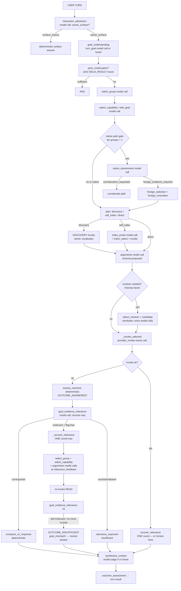
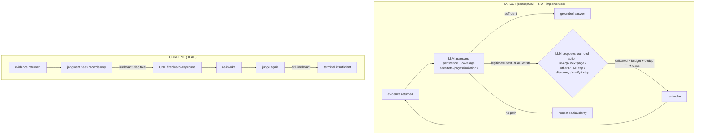

# 164 — DÉLIA · R0 Architecture Audit — LLM-Native Iterative Tool Research

- **Task ID:** `DELIA-C3-LLM-NATIVE-ITERATIVE-RESEARCH-ARCHITECTURE-AUDIT-01`
- **Date:** 2026-10-27
- **Type:** Documentation-first architecture audit (R0 of the doc-163 roadmap)
- **Status:** AUDIT_COMPLETE — no code, prompt, model, catalog, provider or infrastructure modified
- **Product direction:** Document 163 (TARGET; not accepted architecture)
- **Evidence base:** Documents 150–163 + independent reviews `7990afbc`, `f2167592`

---

## 1. Executive summary

The current orchestration already contains **most of the machinery** needed for governed iterative research: a bounded relevance-recovery round that re-selects group/capability, consults foreign evidence, re-proposes arguments with a feedback channel, and re-invokes a resumable READ — all under live re-validation. The single-query production trace (doc 162) exercised exactly this machinery.

**Three structural blockers prevent LLM-led iterative research today:**

1. **ONE recovery round per interaction, hard-coded.** `_RELEVANCE_RECOVERY_USED` (ContextVar, request-scoped) is set on the first recovery and checked at every subsequent eligibility point. After the second `irrelevant` judgment the flow deterministically degrades to `OUTCOME_INSUFFICIENT`/`goal_mismatch`. There is no model-led decision about *which* next step to take — the continuation shape (reselect→args→reinvoke→rejudge) is fixed in code.
2. **Coverage/pagination metadata is extracted but never reaches the model.** `outcome_facts()` already computes `total_count`, `coverage_complete`, `has_more` from the owner envelope — but the relevance-judgment block and the recovery `prior_result_preview` carry only `records`. The model cannot distinguish "3 irrelevant records are the whole space" from "3 of 1,855 across 619 pages". It therefore has no evidence basis to choose page-advance over reformulation.
3. **Deterministic page-walk exists but only for COUNT intent.** `_maybe_aggregate_paginated_count` advances `page` deterministically up to 20 pages, budget-gated — but it fires only when `classify_result_intent == COUNT`. For LIST/SEARCH goals nothing proposes deeper pages, and the recovery round does not surface `total`/`total_pages` either.

None of the blockers requires a new engine, new provider, or new authority. All are inside `OperationalCapabilityOrchestrator` plus the existing EvidenceFacts contract.

**Owner-contract finding (proven, not assumed):** `delpi.search_products` description matching is whitespace-tokenized `LIKE 'term%'` **prefix-per-token, OR'd**, ranked `100·phrase-prefix + 20·term-prefix`, then description/code alphabetical (TOTVS repository). `page`/`page_size`/`total`/`total_pages` are first-class contract members. `is_complete` on `SpecialistOutcome` means *transport/result completeness*, not business coverage — confirming the independent-review residual in doc 162 §11.

## 2. Reanchor

| Field | Value |
|---|---|
| `BASE_HEAD` | `4e94754713` (ancestor) |
| `ORIGIN_MAIN` | `4499d4f2b5` at execution — includes doc 163 (`807da4c0`) and independent review `f2167592` |
| `WORKTREE_STATUS` | `delia-semrel-wt`, clean; ff-only pull applied; concurrent proc-0076/cf work preserved untouched |
| `AUTHORITIES_READ` | 16 → 50 → 17 → 49 → 51 → 52 → 21 → 20 → 25; docs 150–163; reviews `7990afbc`, `f2167592`; Execution Ledger |
| `CURRENT_PHASE` | C3 — R0 audit per doc 163 §6 |
| `CP_RQ` | NOT_ADVANCED |
| `EVALUATED_SHA` | `4499d4f2b5` (same `orchestration.py` sha256 `8513a5d6…` as production runtime verified in doc 161) |

No canonical conflict detected between doc 163 direction and frozen decisions: doc 163 itself records TARGET/PLANNED status and mandates this audit before design.

## 3. Execution map — CURRENT (verified at HEAD)

All paths under `delia-api/app/application/capability_provision/orchestration.py` unless noted. One governed attempt (`_attempt`, L4227–5709) executes:

### Stage inventory (each `stage=` verified in source)

| Stage | File:line | Model call | Deterministic gate | Notes |
|---|---|---|---|---|
| `interaction_admission` | L9915 `_admit_conversational_turn` | YES (admission instr) | typed class parse, budget gate | skips owners only for declared surface_inquiry |
| `prior_continuation` | L6431 `_prior_continuation_attempt` | YES (synthesis-selection) | prior DELIA_RESULT required | multi-turn evidence reuse |
| `goal_understanding`/`turn_goal` | L6318 `_understand_goal` | YES (turn_goal instr, conditional) | `_turn_goal_from_proposal` | fused into select_capability when goal_class present |
| `intent_reconciliation` | L4541–4589 | part of selection | contradiction gate | |
| `select_group` | L10055 | YES (select_group instr) | membership in live groups | fallback reserve budget |
| `select_capability` | L10198/L10293 | YES | membership + class | with_goal variant |
| `native_assessment` | L6648 `_assess_native_path` | YES | only when `len(groups)>1` | not traversed on direct OPERATIONAL path (docs 161–162) |
| `foreign_selection`/`foreign_invocation` | L6747/L6843 | YES + READ invoke | resumable class, live membership | |
| `plan`/`decision_path` | L4691–4790 | NO | deterministic plan + `select_decision_path` (domain rules) | discovery/self_index/direct; FAST/OPERATIONAL/REASONING telemetry |
| `discovery`/`discovery_retry`/`discovery_terminal` | L4789+, L10826+ | YES (args) + DISCOVERY invoke | envelope-required only | owner vocabulary |
| `index_probe`/`index_select` | L10380–10497 | YES + YES | `_index_selection_is_member`, schema | governed self-index READ |
| `arguments` | L10590 `_build_arguments` | YES | `_schema_keys` + arg validation + `_unproven_identifier_inputs` | sees `input_schema` (incl. `page`), owner/foreign evidence, relevance_feedback |
| `resolver`/`select_candidate`/`candidate_arguments` | L5926+, L11211+, L11346+ | YES ×3 | missing-input binding, identifier provenance | |
| `provider_invoke` | L11395 `_invoke` → `_invoke_selected` L10792 | NO | delegated bearer → owner AuthZ; class gate; deadline; resume-checkpoint record | |
| `pagination` (count walk) | L8879 `_maybe_aggregate_paginated_count` | NO | **COUNT intent only**, `page` arg in schema, `has_more`/`total` envelope, max 20 pages, budget headroom | LIST goals never walk |
| `goal_evidence_relevance` | L9439 `_judge_goal_evidence` | YES | `parse_goal_evidence_judgment` | block = subject+constraints+records+declared_requirements — **no coverage/total/page** |
| `relevance_recovery` | L9519 `_recover_relevance` | YES ×(2–4) | **ONE round** (`_RELEVANCE_RECOVERY_USED`), resumable class, identical-args dedup, budget, unproven-identifier gate | full governed reselection inside the round |
| `cri_response` | L7955 `_compose_cri_response` | NO | deterministic composition | |
| `synthesis` | L9010 `_synthesize_content` | YES (only when cri None) | selection-only, no free prose channel | model may only select/organize records |
| `outcome_assessment` | `_apply_outcome_assessment` L7920 | NO | `assess_outcome` deterministic verdict | ANSWERED/INSUFFICIENT + reasons |
| `comparison`/`corroborate` | L381–, L6939 | YES | two-source deterministic confrontation | |
| `clarification` | L8790 | YES (wording only) | deterministic question content | |
| `governed_resume`/`turn_budget` | L4060–4227 | checkpoint replay | `_AttemptCheckpoint`, max attempts, no mutating replay | |

### Deterministic (non-model) responsibilities — all present and correct

AuthN (`auth_middleware`), delegated bearer (`subject_bearer`, `delegation`), live Core AuthZ (owner routes `@require_any_permission`), schema validation (`argument_validation`, `_schema_keys`), operation-class gates (`_RESUMABLE_OPERATION_CLASSES` = DISCOVERY/READ/ANALYSIS only), write chain (PREPARE→CONFIRM→ACT, L7100–7885), turn deadline (300s monotonic, `turn_budget.py`), per-call model timeout (≤60s), per-call retry cap (≤3, recoverable classes only, `governed_retries.py`), governed resume (`_AttemptCheckpoint`), cancellation probe, evidence sanitization/projection (`outcome_assessment.py`), provenance (`SpecialistResultProvenance`), activity/audit emission. **KEEP all.**

## 4. Model-call map (semantic fragmentation audit)

18 distinct instruction IDs in `config/orchestration_instructions.delpi.json` (v23). Observed single query (doc 162): **10 model calls** — admission, select_group, select_capability, index_probe, arguments, relevance, + recovery round (select_group, select_capability, arguments, relevance#2).

| Model stage | Instruction ID | Sees goal? | Sees prior evidence? | Terminal-failure behavior |
|---|---|---|---|---|
| interaction_admission | `interaction_admission` | input_text | no | deterministic surface answer |
| turn_goal | `turn_goal` | input_text + prior_turns | prior results | neutral default goal |
| select_group | `select_group` | input_text | +`relevance_feedback` on recovery | `none`/`invalid` → fail closed |
| select_capability(+with_goal) | `select_capability` | yes | +`relevance_feedback` | `none` → fail closed |
| native_assessment | `native_assessment` | yes | group+capability context | native path |
| foreign_selection | `foreign_selection` | yes | +`relevance_feedback` | invalid → `invalid_foreign_selection` dead-end (doc 159) |
| index_probe | `index_probe` | yes | contract | skip probe |
| index_select | `index_select` | yes | index rows | membership check |
| arguments | `arguments` | yes | owner_vocabulary, foreign_evidence, **`relevance_feedback` incl. prior_result_preview** | missing → resolver or fail |
| select_resolver | `select_resolver` | yes | missing inputs | args_failed |
| select_candidate / candidate_arguments | ids per catalog | yes | owner candidates | unusable → terminal discovery |
| analysis_continuation | `analysis_continuation` | yes | analysis outcome | no PREPARE |
| comparison | `comparison` | yes | two evidence sets | truthful miss |
| clarification_wording | `clarification_wording` | yes | — | deterministic fallback wording |
| grounded_synthesis | `grounded_synthesis` | yes | records | selection-only; empty → insufficient |
| goal_evidence_relevance | `goal_evidence_relevance` | subject+constraints | **records only (≤MAX_RELEVANCE_RECORDS)** — **no total/page/has_more** | `uncertain`/invalid → `relevance_unproven` insufficient |

**Classification of the splits (WP1 §7):**

- **A — necessary (safety/contract):** independent schema validation per stage; resumable-class gate on recovery; unproven-identifier gate; deterministic verdict. KEEP.
- **B — necessary (cost/context):** per-stage typed blocks + `_fit_json_block` truncation ladder; admission early-exit. KEEP.
- **C — useful, simplifiable:** select_group→select_capability could propose a joint selection on single-group surfaces (already partially fused via `with_goal`); turn_goal fusion already exists. SIMPLIFY candidates.
- **D — fragmentation that loses evidence:** the relevance/recovery judgments never receive coverage metadata extracted one layer below (`total_count`, `coverage_complete`, page envelope). Evidence continuity exists for *records* (`prior_result_preview`) but not for *space size*. This is the core semantic-context gap.
- **E — obsolete/duplicated:** none proven; `native_assessment`/`foreign_selection` are not obsolete — they are simply not traversed on direct operational paths (docs 161–162 evidence), and their contract problems (docs 159–160) remain unresolved for the enrichment path.

## 5. Research-continuity audit (WP2) — the central question

**"When a tool returns real but irrelevant data, can the LLM conduct another research attempt?"**

**Partially — exactly once, through a fixed shape.** `_apply_semantic_relevance` (L9761) grants ONE `_recover_relevance` round when `judgment == irrelevant` and the ContextVar flag is free. Inside the round the model may: re-select group, re-select capability, optionally obtain foreign evidence (via `_assess_native_path` under `len(groups)>1`), and re-propose arguments informed by `relevance_feedback` (prior_correspondence + `mismatch_hint` + `business_subject` + `prior_result_preview` of records). Identical args on the same capability are deduped; failure keeps the original insufficiency.

**What the model cannot do today:**

| Needed continuation (doc 163 TARGET) | Supported? | Evidence |
|---|---|---|
| `ANSWER_WITH_EVIDENCE` | YES | `OUTCOME_ANSWERED` path |
| `REFINE_SAME_CAPABILITY` | YES — once | recovery round re-args (doc 162: `TERM BALA` reformulation) |
| `FETCH_NEXT_PAGE` | **NO for LIST** | `page` exists in owner schema + walks exist for COUNT only (L8879–9010); no coverage signal reaches the model |
| `USE_ANOTHER_AUTHORIZED_CAPABILITY` | YES — once | governed reselection inside the round |
| `REQUEST_DOCUMENTATION` | partial | foreign consult inside the round; no owner-docs capability contract |
| `ASK_CLARIFICATION` | YES | clarification stage |
| `REPORT_PARTIAL` | YES | INSUFFICIENT + reasons + limitations |
| `STOP_NO_PROGRESS` | YES — deterministic | one-round cap + identical-args dedup (not model-declared) |
| `STOP_AUTHORIZATION` | YES | AUTHZ_DENIED / mcp_authorization_denied |
| `STOP_BUDGET` | YES | TurnDeadline + `_budget_allows_resolver` |
| Second/third bounded READ after new evidence | **NO** | `_RELEVANCE_RECOVERY_USED` blocks round 2 |

**Premature-stop cases with code evidence:**

1. `orchestration.py:9824-9828` — `irrelevant` + flag already used → falls through to `OUTCOME_INSUFFICIENT`/`goal_mismatch`. Doc 162 turn hit exactly this: second `TERM BALA` page judged irrelevant → terminal, while `total_pages≈619` remained unexplored.
2. `orchestration.py:8936-8940` — page-walk gated by `intent == COUNT`; a "list 3 examples" goal can never consume the existing walk.
3. `orchestration.py:9458-9475` — judgment block omits envelope metadata; the model's `irrelevant` verdict is formed blind to `total_count`/`has_more`, so even legitimate "wrong page" states are classified the same as "wrong space".
4. `orchestration.py:9593` — `_RELEVANCE_RECOVERY_USED.set(True)` fires before the round, so a failed/recoverable first recovery still consumes the only round.

**Legitimate stops that must be preserved:** AuthZ denial, mutating-class rejection, identical-argument dedup, budget exhaustion, plan-validation failure, `_unproven_identifier_inputs`, mutating-invoke-started resume barrier.

## 6. Owner search contract — `delpi.search_products` (WP3, contract-first per review `f2167592`)

| Aspect | Proven contract | Source |
|---|---|---|
| Route | `GET /apps/api-delpi/products/search` | `product_routes.py:209` |
| AuthZ | `ENGINEERING_LMP_ACCESS` (`api-delpi.access`/`dashboard-engineering.view`/`dashboard-lmps.view`) | `product_search_auth.py` |
| Params | `code, group_code, description, customer_reference, page≥1, page_size (route cap), sort, direction` | `product_routes.py:211-216` |
| Description match | whitespace `split()`; each token `B1_DESC LIKE '{term}%'` **prefix**, **OR'd** | `product_repository.py:61-74` |
| Ranking | `relevance_score = 100·(desc LIKE 'phrase%') + Σ20·(desc LIKE 'term%')` DESC, then `B1_DESC, B1_COD` | `product_repository.py:76-120` |
| Pagination | `page`, `page_size`, response carries `items, page, page_size, total, total_pages` | `product_search_projection.py:25-33` |
| `is_complete` | transport/result completeness flag on `SpecialistOutcome` — **not** business coverage | `specialist_interop/model.py:134`; `mcp/adapter.py:382` |
| Coverage fields | `total`/`total_pages` mapped to `total_count`/`coverage_complete` by `outcome_facts` | `outcome_assessment.py:1517-1545` |

Consequence proven in production (doc 162): `description="TERM BALA"` → `B1_DESC LIKE 'TERM%' OR LIKE 'BALA%'` → 1855 rows; `TERM. BALA …` cannot satisfy phrase-prefix `TERM BALA%` (literal dot), scores only +20 like thousands of `TERM*` products; `BALA%` adds +20 to BALANCA/BALANCIM → alphabetical tie-break puts them top. The contract is **literal prefix, not semantic** — a real constraint the LLM cannot see and no amount of iteration fully fixes without either deeper pagination (real `TERM. BALA` rows exist deeper) or owner-side ranking evolution (owner decision, not this audit).

Catalog/context the model sees: `openapi_declarations.delpi.json` gives `capability_id`/`semantic_name`/`operation_character`; the full `input_schema` (incl. `page`) reaches `_build_arguments`; group/capability `description` reaches selection stages. Adequate surface; no separate "tool docs" retrieval capability exists.

## 7. State, evidence & pagination

- **Session context:** `prior_turns` + `prior_continuation` reuse prior DELIA_RESULT content; no evidence store across rounds beyond the recovery preview.
- **Evidence continuity:** `EvidenceFacts`/`outcome_facts` typed projection; `prior_result_preview` records reach the recovery argument proposal — good.
- **Coverage continuity:** `total_count`/`coverage_complete`/`has_more` extracted but dropped before model stages — gap identified in §5.
- **Checkpoint:** `_AttemptCheckpoint` stores verified non-mutating invoke outcomes keyed by (group, capability, canonical args) — existing per-interaction evidence cache usable by a future bounded-iteration mechanism without new persistence.
- **Pagination:** owner `page` arg + deterministic walk machinery + envelope extractor — all present; disconnected from semantic continuation.

## 8. Reuse gate (WP4)

| Need for LLM-led iteration | Existing equivalent | REUSE_DECISION |
|---|---|---|
| bounded extra READ rounds | `_recover_relevance` machinery + `_RESUMABLE_OPERATION_CLASSES` + identical-args dedup + budget gates | EXTEND (round count → bounded N under budget, not fixed 1) |
| evidence into next decision | `relevance_feedback` channel (select_group/capability/arguments) | REUSE |
| coverage signals | `extract_pagination_envelope` + `EvidenceFacts.total_count/coverage_complete` | EXTEND (surface into judgment/recovery blocks) |
| page advance | owner `page` arg + `_maybe_aggregate_paginated_count` walk + `extract_pagination_envelope` | EXTEND (model-proposed `page` args already validate today) |
| multi-call identity | `interaction_id`/`correlation` + `_AttemptCheckpoint.invoke_outcomes` | REUSE |
| next-step decision | NO existing "choose next READ action" model stage | NEW *model stage only* — not a new engine; same `_propose` port |
| stop conditions | deadline, budget gates, dedup, class gate, resume barrier | REUSE verbatim |
| R1 harness | `delia-api/scripts/instruction_ab_eval.py` + stage-local eval pattern + `delia-json` (qwen2.5:3b) local model | REUSE |

`EXISTING_EQUIVALENT=YES` for every needed mechanism except the *decision point* itself — which is a stage, not a subsystem. No new planner/engine justified.

## 9. Responsibility matrix (WP5)

| Component | Classification | Evidence / rationale |
|---|---|---|
| interaction_admission | KEEP | early surface-vs-owner split, budget-aware |
| turn_goal / goal fusion | KEEP (already fused where possible) | L4507-4519 |
| select_group + select_capability | SIMPLIFY | two calls where one joint proposal may suffice on small surfaces; keep gates |
| prior_continuation | KEEP | multi-turn evidence reuse |
| native_assessment / foreign_selection | NEEDS_OWNER_CONTRACT | correct on enrichment path but doc-159/160 deviation unresolved; not exercised by operational reads |
| discovery / index_probe / index_select | KEEP | governed owner-vocabulary/self-index paths |
| arguments (`_build_arguments`) | KEEP | schema-validated, evidence-fed |
| resolver + candidate stages | KEEP | required-input binding |
| `_invoke_selected` + AuthZ chain | KEEP | per-invocation delegated authorization |
| `goal_evidence_relevance` | EXTEND | block must carry envelope/coverage metadata (records-only today → blind verdicts) |
| `_recover_relevance` | EXTEND | mechanism sound; fixed-at-one round is the premature-stop source |
| `_maybe_aggregate_paginated_count` | EXTEND | LIST-intent walks; currently COUNT-only deterministic |
| `_RELEVANCE_RECOVERY_USED` single flag | REMOVE_CANDIDATE → replace by bounded iteration ledger (rounds, dedup, budget) | L3828/4112/9593/9825 — hypothesis only, needs R1 proof |
| `_synthesize_content` selection-only | KEEP | no free-prose channel is a security property |
| CRI composition + outcome_assessment | KEEP | deterministic verdict owner |
| PREPARE/CONFIRM/ACT chain | KEEP — untouched | material frontier correct |
| governed retry / resume / deadline | KEEP | reuse for iteration bounds |
| `is_complete` naming | NEEDS_OWNER_CONTRACT | ambiguous semantics (transport vs coverage) — clarify doc/contract, not code here |

## 10. CURRENT × TARGET delta

Diffs required for TARGET (all inside existing orchestrator + instruction resource — no new subsystem):

1. Surface `total_count`/`coverage_complete`/`has_more`/`page` into relevance + recovery context (data already extracted).
2. Replace the boolean one-round flag with a bounded iteration ledger: max R rounds (R≈3 proposal), existing dedup/budget/class gates per round.
3. One new model stage (same `_propose` port, new instruction resource entry) that proposes the next governed action from an enumerated contract — code validates, never trusts.
4. Explicit page-advance as a first-class proposed action (contract arg already exists).

## 11. Risks / open questions

- Owner prefix-match semantics limit what iteration can recover; deeper pages help but cannot guarantee pertinence — must be measured, not assumed (R1).
- Iteration multiplies model calls/tokens; budget interaction with 300s/60s caps must be measured — possible need to rebalance stage budgets (contract decision, not silent change).
- `native_assessment`/`foreign_selection` remain untested in production for this path; enrichment-path defects (docs 159–160) are orthogonal and unfixed.
- Whether qwen2.5:3b can drive a next-action decision stage is unknown — R1 measures exactly this.
- RBAC grant ratification for `devin-smoke-r4` remains an open governance residual (docs 162/§11) — separate owner action.

## 12. R1 experiment plan (PLANNED — not executed; awaits coordination approval)

**Objective:** prove or refute that the *same local model* can drive bounded iterative research with existing tools, improving Business Outcome on first-page-irrelevant searches without security regression.

| Field | Plan |
|---|---|
| `R1_EXPERIMENT_PLAN` | Harness A/B on frozen local stack (`delia-json` = qwen2.5:3b, same catalog surface, same owner fixtures/snapshots). A=CURRENT orchestration path. B=prototype composition inside eval harness only: after evidence, a bounded next-action stage proposes {re_arg_same, next_page, reselect_read, request_discovery, ask_clarification, stop_partial, stop} ≤3 rounds; code applies identical gates (schema, class, AuthZ mock, dedup, budgets). No productive code change. |
| `R1_CORPUS` | ≥14 case families: description search; code search; first-page-irrelevant (the doc-162 pattern); pagination-required; documental; analytic; discovery; comparison; nonexistent info; ambiguous ask; owner failure; AuthZ denied; prompt-injection in tool output; unauthorized WRITE ask + holdout set not used for tuning |
| `R1_METRICS` | BUSINESS_OUTCOME PASS/PARTIAL/FAIL (primary); FIRST_SEARCH_RELEVANCE; REFINEMENT_ATTEMPTS/SUCCESS; AUTHORIZED_TOOL_CALLS; MODEL_CALL_COUNT; INPUT/OUTPUT_TOKENS; LATENCY; INVALID_ARGUMENTS; INVALID_CAPABILITY_SELECTION; OWNER_ERRORS; STOP_REASON distribution; AUTHZ_BYPASSES; UNAUTHORIZED_ACTIONS; FABRICATED_RECORDS |
| `R1_SECURITY_GATES` | READ-only classes; per-invocation AuthZ check preserved; schema validation per call; max rounds + identical-args dedup + token/time budgets; tool output untrusted; no CoT persistence; injection corpus must not produce elevated privileges |
| `R1_ACCEPTANCE_CRITERIA` | B shows statistically meaningful OUTCOME improvement on first-page-irrelevant/pagination families vs A at same model/config; 0 fabricated records; 0 AuthZ bypass; regression-free on nonexistent/ambiguous/negative families (honest limitation); stop-reason distribution bounded (no loops). Otherwise INCONCLUSIVE/REWORK — baseline retained. |
| Model freeze | local `delia-json` (qwen2.5:3b); confirm digest/config at R1 start; no production-model tokens; no model swap to favor B |
| Prohibited in B | regex/keyword routing; capability special-casing (incl. products); provider ordering; oracle answers; new provider/authority |

## 13. Evidence & limitations

- Audit is static code + contract + production-trace corroboration (docs 161–162); no new runtime probe executed (none authorized).
- `orchestration.py` is ~11.6k lines; inventory covered every `stage=` marker, all model-stage entry points, and the full invoke/recover/paginate/resume chain — residual call-site sweep performed (loops: only the count-walk at L8936 and retry/resume loops; no hidden iteration).
- Some stage internals (comparison/corroborate, media providers) were inventoried at contract level, not exhaustively.
- Docs 150–157 read via ledger/document records; 158–163 read in full this session.

## 14. Recommended next direction

`NEXT_BOUNDED_STEP` = R1 approval decision by coordination (per doc 163 §6 gate). Recommended focus order for R1-B prototype: (1) coverage-metadata surfacing, (2) bounded round ledger, (3) enumerated next-action stage. All reuse existing ports/gates; none touches production.

`EXECUTION_DRIFT=NONE` — audit-only scope respected throughout.

## 15. Independent coordination review — 2026-10-27

**VERDICT=ACCEPT_WITH_RESIDUAL (R0 static audit), R1_PRODUCTION_IMPLEMENTATION=NOT_AUTHORIZED, R1_LOCAL_PROTOTYPE=RECOMMENDED_FOR_SEPARATE_BOUNDED_TASK.** This review inspected the published doc 164 and its evidence at current GitHub HEAD; it did not independently execute runtime code, reproduce source line numbers, or benchmark the 3B model. The R0 audit-only output is in scope and records a useful owner contract and call graph. Treat reported implementation details as code-inspection findings pending independent spot checks at frozen SHA `4499d4f2b5`, not production performance proof.

**Strong architectural direction:** reuse existing `_recover_relevance`, relevance feedback, checkpoint/dedup, per-call Core/Domain AuthZ, schema gates, deadline and owner `page/page_size/total/total_pages`. A one-round guard, absent coverage fields in model-facing relevance/recovery blocks, and COUNT-only page-walk are credible structural limitations; the doc-162 trace supports honest rejection of irrelevant first-page records while more candidate pages existed. `is_complete` must not be mistaken for exhaustive coverage. None of this by itself proves that a second read finds semantically relevant records or that paging thousands of broadly matched results is efficient.

**Key design challenge:** the proposed 'NEW model stage' and boolean→ledger change are **hypotheses**, not preapproved structures. Before adding an instruction/resource/model call or state abstraction, test whether the existing `_propose`/recovery decision can express a next authorized READ with existing typed contracts; justify any new stage by owner/consumer/contract, savings in coupling and outcome. Likewise, a fixed three-round cap is an experimental budget, not a product invariant or license for repeated near-duplicate calls. Stop on no-progress, duplicate query, budget, AuthZ or untrusted metadata; preserve read/write, PREPARE/ACT and owner authority.

**R1 evidence requirements:** paired current-versus-local experimental continuation, same frozen local model/config/corpus and authorized owner fixtures, exact model-facing coverage projection, per-stage engagement, query/page progression, repeated READ authorization and provenance, business-record relevance verified by oracle, negative/holdout and injection cases, model/tool calls, tokens, latency and no-progress stops. Avoid special casing `terminal bala`, hardcoded provider branches, regex semantics, new parallel engine or production integration. If a local harness cannot faithfully exercise the existing orchestration and security boundaries, mark it INCONCLUSIVE rather than treating mocked gates as production security evidence.

**Coordination decision:** accept R0 documentation with residual; authorize **planning of a bounded R1 eval-only task**, not productive implementation, new provider, deployment or production token consumption. Keep Core RBAC grant ratification separate. Architecture choices remain subject to canonical reanchor and independent review after R1.
