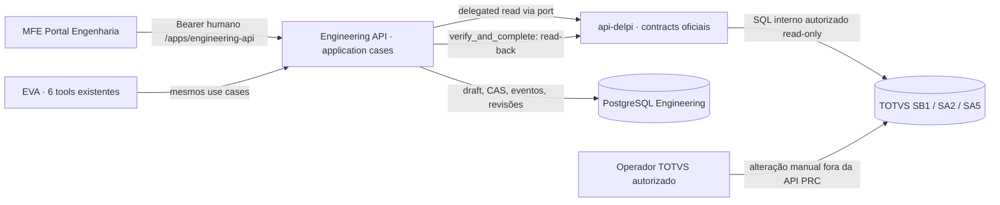

# D12 — Blueprint executável: rotas, api-delpi, casos de uso e frontend UPDATE seletivo (SB1 + SA5)

**Status:** `INVENTORY_VERIFIED / TARGET_CONTRACT_PROPOSED / OWNER_SIGNOFF_REQUIRED / IMPLEMENTATION_PENDING / PRODUCTION_DEPLOY_SUSPENDED`  
**Data:** 2026-11-08 · **Owner Coordination:** Portal Engenharia / EVA · **Documento-base:** [REF-012](./MFE-PRC-REF-012-INDIVIDUAL-FIELDS-AND-SUPPLIER-LINK-OPERATIONS.md).  
**Repo canônico:** `roberiooliveiradev/delpi-central` / main no momento do inventário. Revalidar HEAD e `AGENTS.md` no começo da execução.  
**Propósito:** não deixar o Devin escolher arbitrariamente rota, fonte, payload, revisão, operação sobre SA5 nem interface.

> **Legenda:** `PROVEN` = observado no código em main; `TO_INVENTORY` = confirmação de contrato/semântica pendente; `TARGET` = solução proposta, **ainda não implementada**. **Não afirmar que os novos endpoints ou payloads já existem**. Aprovação PO: edição individual com exibição dos valores atuais oficiais; adicionar/alterar vínculo SA5 específico. **Remoção de vínculo SA5 não autorizada neste escopo**. Mudança de owner/SoT/bounded context: `ARCHITECTURE_DECISION_REQUIRED` à Coordination.

## 1. Ownership e dependências — ordem correta

| Owner | Responsabilidade | NÃO fazer |
|---|---|---|
| Keycloak | AuthN/SSO, identidade humana | guardar token em draft, memória ou logs |
| Core | catálogo RBAC / `engineering.access`, `engineering.manager` | inventar permissões PRC granulares |
| Portal Engenharia / MFE | experiência, forms, read dos valores oficiais e mudanças propostas | SQL/ODBC/TOTVS direto; atribuir autorização |
| Engineering API | caso de uso de leitura para edição, validação, draft, operações seletivas, CAS, verificação, revisão imutável | escrever no ERP, ler banco alheio, consumir `supplies-api` |
| `api-delpi` | contratos de leitura oficial e acesso autorizado SB1/SA2/SA5 | criar fluxos de escrita ERP por esta feature |
| TOTVS | fonte oficial de produto SB1 e amarração SA5; operador funcional altera manualmente | presumir que read-back já efetivou mudança |
| EVA | consumidora dos mesmos use cases, somente dentro do envelope governado | tools extra, autorização própria ou caminho alternativo |
| Engenharia owner | decisão final de campos e regras de mudança/comparação | aprovar por inferência do modelo |



## 2. Inventário PROVEN — rotas Engenharia que já existem

**Prefixo público:** `/apps/engineering-api/v1/product-registration` (interno `/v1/product-registration`).  
**Owner técnico:** `engineering-api/engineering_app/interface/http/routes/product_registration_routes.py`.

| Método | Rota a partir do prefixo | Propósito atual | D12 |
|---|---|---|---|
| POST | `/intake/requests` | CREATE/UPDATE; `changes[{path,proposedValue,reason}]`, `Idempotency-Key`, revisão técnica resolvida no backend | **estender contrato UPDATE** para operações SA5 individuais, sem quebrar CREATE/consumidores |
| GET | `/requests` | fila paginada, filtros e sort | manter |
| GET | `/requests/{id}` | detalhe, draft, versão, `allowedActions` | mostrar diffs individuais no detalhe |
| GET | `/requests/{id}/timeline` | eventos append-only | eventos `supplier_link_added/updated` ou metadata sem mudar owner |
| PATCH | `/requests/{id}/draft` | edição seletiva do draft com `expectedVersion` e `changes[]` | estender para mudar/remover **proposta** de operação individual; não confundir com remoção de vínculo ERP |
| POST | `/requests/{id}/actions/start` | início | manter |
| POST | `/requests/{id}/actions/resume` | retomada | manter |
| POST | `/requests/{id}/actions/submit-review` | encaminhar à revisão | manter |
| POST | `/requests/{id}/actions/request-information` | pendência | manter |
| POST | `/requests/{id}/actions/reject` | rejeição | manter |
| POST | `/requests/{id}/actions/verify-and-complete` | read-back via api-delpi + publicação revisão imutável | **comparação seletiva SB1/SA5 e pós-condições por operação** |
| GET | `/requests/{id}/verifications` | verificações detalhadas | evidenciar por vínculo e atributo |
| GET | `/technical-records/{id}` | ficha técnica publicada Engenharia | preservar |
| GET | `/technical-records/{id}/revisions` | índice imutável | preservar |
| GET | `/technical-records/{id}/revisions/{number}` | snapshot imutável | preservar |
| GET | `/reference-data` | campos/enums e policy | preservar; se necessário adicionar capability flag formal |
| GET | `/reference-data/catalogs/{catalog}` | 4 catálogos oficiais via api-delpi | usar sem duplicar: `product-groups`, `units`, `warehouses`, `accounting-accounts` |
| GET | `/reference-data/suppliers/search?query=&page=&pageSize=` | lookup SA2 remoto por código/razão/fantasia | usar para **add**, não substituir leitura SA5 existente |
| GET | `/outbound/requests` e `/outbound/requests/{id}` | outbound de integração | manter, avaliar compatibilidade do shape |

**Observação importante do inventário:** o docstring do router ainda menciona permissões granulares antigas, **mas o código efetivo** usa `ENG_ACCESS` para read/create/process. Não copiar o comentário obsoleto como regra de AuthZ.

### Novo endpoint de aplicação — TARGET (apenas 1 read BFF)

**Proposta preferencial:** `GET /apps/engineering-api/v1/product-registration/reference-data/products/{officialCode}/edit-context`.

Motivos: a UX exige snapshot SB1 + SA5 de uma mesma consulta contextual com status/provenance; o browser **não** deverá chamar api-delpi; evita espalhar 2–3 endpoints externos pela tela. Caso exista um read case equivalente oficial, reutilizá-lo e documentar escolha em vez de criar novo path.

**Request:** path `officialCode` (código validado/encoded), Bearer humano, request-id; sem mutação. **Response `TARGET` ilustrativa:**

```json
{
  "officialProductCode": "90264270",
  "source": "TOTVS",
  "consultedAt": "<ISO 8601 from Engineering API read>",
  "status": "available",
  "product": {
    "description": "<valor SB1>",
    "group": "<B1_GRUPO>",
    "type": "<B1_TIPO>",
    "unit": "<B1_UM>",
    "defaultWarehouse": "<B1_LOCPAD>",
    "accountingAccount": "<B1_CONTA>",
    "thirdPartyProduct": "<B1_TPMAT>",
    "customerReference": "<B1_REFEREN>"
  },
  "supplierLinks": [
    {
      "supplierCode": "000089",
      "store": "01",
      "supplierName": "<SA2.A2_NOME>",
      "partNumber": "",
      "catalogNumber": "<SA5.A5_CODPRCA>"
    }
  ],
  "supplierLinksPageInfo": {"complete": true, "total": 1},
  "technicalBaseline": {"status": "available_or_none", "revisionHandledByBackend": true}
}
```

**Contrato DTO não é código existente.** Os valores de `product` devem ser mapeados explicitamente **da projeção real** de `api-delpi` (ex.: `description`, `group_code`, `type`, `unit`, `default_warehouse`, `accounting_account`) para a convenção camelCase frontend/PRC, sem supor homonímia. Verificar `thirdPartyProduct` ↔ campo real autorizado: não inventar `B1_TPMAT` na projeção se ausente. Cada item deve indicar disponibilidade; campo indisponível ≠ string vazia.

**Erros:** 401 sem autenticação; 403 sem `engineering.access` ou read oficial proibido; 404 produto não encontrado; 409 se regra de baseline conflitar (em escrita, não GET, salvo protocolo documentado); 422 código inválido; 503/504 dependência indisponível/timeout; 502/contract_error se shape oficial incompatível; sem fallback fake. Error envelope conforme padrão do Core/Engineering API. Sem dados protegidos em logs.

**Completeness:** a implementação atual do `OfficialProductReader` consulta SA5 **somente página 1 com `page_size=500`**; o novo edit-context não pode afirmar `complete=true` sem verificar total/paginação/limites do endpoint. Para produtos com >500 vínculos, paginação integral limitada ou endpoint específico (proposto pelo owner) com cursor/total; fail-closed para write/compare que dependa de conjunto incompleto.

**Provenance:** `consultedAt` é horário da leitura da Engineering API, não o instante da modificação no TOTVS; `source`/correlation id interno/audit; `technicalBaseline` pertence à Engineering API, nunca à revisão ERP `current_revision`.

## 3. Inventário PROVEN — contratos api-delpi consumíveis

Owner: `api-delpi`; browser **não** consome diretamente. Adapter existente: `engineering-api/engineering_app/infrastructure/gateways/delegated_auxiliary.py` e `official_product_reader.py`.

| Consulta `api-delpi` | Dados e fonte verificados | Uso em D12 | Situação |
|---|---|---|---|
| `GET /products/{code}?view=engineering` | Projeção SB1; allowlist `PRODUCT_DETAIL_ENGINEERING_FIELDS` inclui `description`, `type`, `group_code`, `unit`, `default_warehouse`, `accounting_account`, `customer_reference` | **ler valores atuais do produto**; mostrar before | `PROVEN` como consumo/read |
| `GET /products/{code}/suppliers?view=engineering&page=1&page_size=...` | Relação `SA5010` → SA2, `A5_FORNECE`, `A5_LOJA`, `A5_CODPRF`, `A5_CODPRCA`, nome SA2; projeção `PRODUCT_SUPPLIER_ENGINEERING_FIELDS` tem `supplier_code`, `supplier_store`, `supplier_name`, `supplier_part_number`, `catalog_code` | **listar amarrações SA5 atuais**, PN/catálogo e baseline do vínculo selecionado | `PROVEN` como read; completude paginada precisa prova |
| `GET /engineering/product-registration/suppliers?query=...&page=...&page_size=...` | Pesquisa mestre `SA2` por código/nome/razão reduzida | **buscar fornecedor para nova amarração** (ou lookup auxiliar), nunca inferir que SA2 prova vínculo SA5 | `PROVEN` |
| `GET /engineering/product-registration/catalogs/{kind}?query=...&limit=...` | `product-groups`, `units`, `warehouses`, `accounting-accounts` | Selects para **novo valor** dos campos SB1 | `PROVEN` |
| Tipo e Produto de terceiros | Enums oficiais do domain/reference-data Engineering API | novo valor conforme enum verdadeiro | `PROVEN` referência; **lacunas de tipos customizados** permanecem `TO_INVENTORY` |

### SQL / SoT — mapeamento que não pode ser confundido

```text
SB1010  produto (B1_COD, B1_DESC, B1_GRUPO, B1_TIPO, B1_UM,
                 B1_LOCPAD, B1_CONTA, B1_TPMAT, B1_REFEREN)
SA2010  fornecedor (A2_COD, A2_LOJA, A2_NOME; A2_NREDUZ quando DTO disponível)
SA5010  relação produto-fornecedor (A5_PRODUTO, A5_FORNECE, A5_LOJA,
                                     A5_CODPRF, A5_CODPRCA)
```

Fonte verificável do SQL SA5: `api-delpi/app/infrastructure/persistence/totvs/product_repositories/product_suppliers_repository.py`. Não supor que toda coluna SB1 listada acima já esteja exposta na `view=engineering`: validar projection e status antes da execução. **A chave lógica proposta `(supplierCode,store)` é por produto; validar filial/duplicidade física ou sequenciamento com owner api-delpi antes de operações técnicas.** Caso SA5 exponha linhas repetidas para mesma chave, não escolher primeira ocorrência; retornar `ambiguous` e bloquear edição.

**Não planejar uma rota `POST/PUT/PATCH /products/{code}/suppliers` na api-delpi.** A D12 é de **solicitação interna candidata**; o operador faz o trabalho no ERP por canal oficial externo, e Engenharia executa `verify-and-complete` somente depois.

## 4. API Engenharia TARGET — contrato mínimo de escrita seletiva

### 4.1 Decisão de design a validar no owner

**Preservar `POST /intake/requests` e `PATCH /requests/{id}/draft` existentes; evitar criar 1 rota por ação SA5.** É um aumento do application contract com **shape tipado e discriminado**, executado pelos mesmos use cases REST/EVA, não um CRUD de tabela ERP.

**Forma proposta (TARGET, requer versão explícita e owner signoff):**

```json
{
  "source": "portal-engineering",
  "requestType": "update",
  "officialProductCode": "<codigo>",
  "changes": [
    {"path": "accountingAccount", "proposedValue": "<conta>", "reason": "<motivo>"}
  ],
  "supplierLinkChanges": [
    {
      "operation": "update",
      "key": {"supplierCode": "000089", "store": "01"},
      "fields": {"partNumber": "<PN novo>"},
      "reason": "<motivo individual>"
    },
    {
      "operation": "add",
      "key": {"supplierCode": "001572", "store": "01"},
      "fields": {"partNumber": "", "catalogNumber": "<referencia>"},
      "reason": "<motivo individual>"
    }
  ],
  "schemaVersion": "<versao contratual aprovada>"
}
```

**Observações:** 1) shape candidato, não request aceito hoje; 2) atualizar `IntakeBody`, DTO de aplicação, domínio, persistência/revision_changes, REST/EVA e testes antes de enviar; 3) versão contratual hoje é 1 e o use case atual rejeita valores divergentes: planejar compatibilidade de contratos **sem ativar versão arbitrária**; 4) para UPDATE somente de fornecedores, `changes=[]` deve ser admitido quando `supplierLinkChanges` não vazio e validado; hoje `validate_update_changes` exige 1+ scalar change; 5) não permitir `changes[{path:"suppliers",proposedValue:[lista]}]` simultaneamente com operações granulares; rejeitar combinações ambíguas; manter caminho legacy somente com política explícita de compatibilidade, evitando comportamento silencioso.

**PATCH draft:** usar mesma shape discriminada com `expectedVersion`, `Idempotency-Key` e operações de **edição da proposta**, sem alterar ERP. Diferenciar **retirar uma operação candidata do draft** (permitido) de **remover vínculo no TOTVS** (não autorizado). Versionamento CAS, atomicidade, ordering idempotente e justificativa individual obrigatórios.

**Validação:** 1 scalar change por path; 1 operação por chave SA5 por solicitação (ou resolver conflitos com semântica formal); `update` exige vínculo no baseline; `add` exige ausência inequívoca no baseline; campos allowlist `partNumber`, `catalogNumber`, com propriedade **ausente** = não alterar, propriedade presente `""` = limpar explicitamente quando operação `update`; `null` só após semântica aprovada. Não aceitar `remove`. Não aceitar cod/loja desconhecidos, duplicados, ambiguous, sem acesso, incompletos. Justificativa obrigatória por operação.

### 4.2 Error contract esperado

| Situação | Resultado |
|---|---|
| Produto / vínculo oficial inexistente para `update` | 404 ou 409 sem mascarar baseline; especificar pela convenção existente |
| `add` de vínculo já existente | 409 `duplicate_link` |
| Mudança concorrente da revisão técnica | 409 `stale_revision` ou `stale_version` conforme fase |
| Mudança do atributo-alvo desde baseline sem revalidação | 409 `stale_official_snapshot` proposto, ou gate explícito de atualização de snapshot |
| Chave SA5 ambígua/duplicada | 409/422 `ambiguous_official_link` conforme contrato |
| Propriedade crítica não exposta na view oficial | `unverifiable` / fail-closed; não `matched` |
| `supplierLinkChanges` com operação `remove` | 422 `unsupported_operation` |
| Falha de origem/timeout | 503/504, sem fallback silencioso |
| Falta de AuthN/AuthZ | 401/403, conforme padrão atual |

Erros concretos devem ser especificados uma vez no domínio/application e propagados por REST/EVA de forma equivalente; não inventar status diferente para frontend e EVA.

## 5. Verificação e revisão publicada — TARGET

**Estado atual PROVEN:** `service._compare()` chama `catalog.compare_suppliers(draft_data["suppliers"], official_suppliers)`; a função considera `unexpected_in_official` qualquer vínculo fora da lista. `_revision_changes()` recupera `before` de revisão técnica anterior da Engenharia. Isso **não pode** ser reutilizado para editar 1 entre N fornecedores sem refatoração.

**Algoritmo D12 proposto:**
1. No **edit-context**, a leitura oficial captura atributos SB1 e vínculos SA5 com metadata `source`, `consultedAt`, código, completude e fingerprint/versionamento de snapshot quando possível. Não inserir valores oficiais no `changedPaths` sem ação do usuário.
2. Na submissão UPDATE, validar `changes` de campos SB1 e `supplierLinkChanges` de SA5 contra baseline oficial autorizado; persistir alterações candidatas e `before` individual. Registrar baseline de proveniência, momento e request-id, nunca bearer token.
3. Ao analisar, apresentar diff `Atual TOTVS → Proposto` por campo/atributo; campos e vínculos não selecionados permanecem sem alteração.
4. Operador TOTVS altera/cadastra manualmente **somente** os vínculos e campos propostos, sob suas regras e permissões.
5. No `verify_and_complete`, reler SB1/SA5 pela api-delpi. Para scalar: comparar somente paths selecionados. Para `update` SA5: localizar **a chave oficial exata**, exigir linha única, comparar **somente os atributos incluídos em `fields`** (inclusive `""` vs preenchido), com campos ausentes = `unverifiable`. Para `add`: baseline comprovava ausência, read-back comprova presença única/atributos; outros fornecedores não entram em `unexpected`.
6. Em erro, persistir tentativa e diff; bloquear publicação. Em correspondência integral, publicar **uma revisão técnica imutável** e eventos atômicos, contendo `supplierLinkChanges` e o before/after em vez de apagar o snapshot dos outros fornecedores.
7. `CREATE` conserva o caminho full-list original e sua comparação, com regressão explícita; `UPDATE` granular não modifica SA5 via API.
8. **Freshness/TOCTOU:** comparar um read-back atual sem overwrite; se a origem atual divergir do baseline em parte que condiciona operação, devolver conflito para replanejamento. Owner Engenharia + owner integração devem aprovar política de freshness e integridade concorrente. Não prometer lock transacional entre Postgres e TOTVS.

**Atenção à integridade do snapshot:** o código atual monta `draft_data` a partir do snapshot da revisão Engenharia; não necessariamente reflete o estado SB1/SA5 atual do TOTVS. Antes oficial deve vir do edit-context/live-read, e não ser confundido com `technical_snapshot` de revisão anterior. Revisão publicada após UPDATE deve ser snapshot técnico coerente com o baseline e changes; não pode transformar supplierLinkChanges em lista parcial `suppliers` que elimina outros vínculos.

## 6. UX/rotas MFE TARGET

**Rota pública existente:** `/apps/engineering/product-registration/new`, wizard CREATE e UPDATE pelo mesmo `PrcCreatePage.tsx`. Detalhes continuam `/apps/engineering/product-registration/{requestId}`; fila `/apps/engineering/product-registration`. **Não criar rota Core/manifest adicional só para D12.**

| Etapa | Componente/experiência | Chamada |
|---|---|---|
| Identificação | `Nova matéria-prima` ou `Alterar produto existente`; UPDATE solicita **somente código oficial**, revisão-base invisível e automática | ao código válido, `GET edit-context/{code}` |
| Leitura oficial | loading / unavailable / 404 / forbidden; banner `Fonte TOTVS · Consultado em ...`; valores SB1 e amarrações SA5 atuais | Engineering API edit-context |
| Ficha técnica SB1 | visual `Campo | Valor atual (TOTVS) | Alterar | Novo valor | Justificativa`; somente campos marcados habilitam Select/input; código+descrição catálogo quando oficial existir | read edit-context + catalogs atuais |
| Amarrações SA5 | tabela **vínculos existentes** por chave; lupa para busca/inspeção, `Editar vínculo` por linha; `Adicionar vínculo` independente usando lookup SA2; não substituir lista toda | edit-context + search SA2 para ADD |
| Edição SA5 | `Part Number atual / novo` e `Catálogo atual / novo` cada um com seletor de alteração; justificativa do vínculo; atributo não alterado não entra no payload | estado local de proposta |
| Revisar e enviar | diff escalar + diff por vínculo com `before → proposed`, reason; outros vínculos `Sem alterações`; confirmação explícita | `POST /intake/requests` (shape D12 aprovado) |
| Após intake | detalhe e revisão mostram alterações individualizadas; ações `allowedActions`, PATCH draft + CAS, verify official | rotas existentes |

**Layout D11 (busca colapsável em linha, colunas separadas, ícones) permanece como direção PO** para selecionar fornecedor na operação ADD. No UPDATE, priorizar vínculos SA5 **já existentes**, e não renderizar 3 linhas vazias nem checkbox “Alterar vínculos” que substitui toda a coleção. Reutilizar `@delpi/plugin-ui` via `engineeringUi.ts`, sem CSS/design system paralelo.

## 7. Plano de implementação — trilha obrigatória para Devin

| Ordem | Entrega | Owner/code | Gate de saída |
|---|---|---|---|
| D12-0 | Inventory canonical HEAD/git, `AGENTS.md`, contratos api-delpi e testes; mapear DTO SB1/SA5, frontend, REST/EVA e SQL interno api-delpi | todos, read-only | evidência `PROVEN / TO_INVENTORY`, nenhum change não autorizado |
| D12-1 | Contract ADR/lightweight especificado: read-context, change shape, schemaVersion/compatibilidade, errors, AuthZ, completude SA5, freshness e postconditions | Engineering + api-delpi owners | **owner signoff**; se mudança de SoT/owner `ARCHITECTURE_DECISION_REQUIRED` |
| D12-2 | Port/application `get_edit_context` + adapter oficial existente, fonte/freshness/pagination; 1 endpoint BFF read | Engineering API | tests 401/403/404/503, 2 fornecedores, >500 links, mapping, no token leak |
| D12-3 | Extensão de domínio change set tipado (scalar + add/update SA5), validation, fingerprint/idempotency, storage and audit, version handling | Engineering API | testes update 1 vínculo entre N; não altera outros; mode CREATE regressions |
| D12-4 | Comparator `verify_and_complete` selective; before/after/revision snapshot immutable | Engineering API | matching/mismatch/unverifiable/ambiguous/missing/offline PG/Postgres/REST/EVA parity |
| D12-5 | MFE UPDATE prefill oficial, individual toggles e editor SA5; D11 search colapsável quando aplicável | Portal Engenharia | screenshots e browser E2E desktop/tablet/mobile; sem lista substitutiva |
| D12-6 | DEV canônico containers afetados, read-back TOTVS real HML/dev autorizado, replay idempotente, audit, docs outcomes | owners | runtime evidence e matriz PASS/FAIL/PENDING; no production deploy |

**Abstraction Gate:** não criar repository extra, generic change-engine, novo bounded context, novos MCP tools ou endpoints do ERP sem necessidade. Preferir use cases/adapters existentes; distinguir “proposta de adicionar” da escrita final por operador.

## 8. Test matrix mínima

- **Leitura (edit-context):** produto existente, inexistente, 403, 503, campos ausentes, tipo custom do TOTVS, PN oficial vazio, catálogo oficial vazio/presente, SA5 com várias lojas/duplicata, >500 vínculos/paginação, timestamp e provenance.
- **Campo SB1:** somente `accountingAccount` alterado; outros 7 intactos; não altera se check sem mudança; valores `""` e ausente; 409 stale tech revision.
- **SA5 UPDATE:** altere PN de 1 entre 3, catálogo de outro, PN `""` intencional, seletor PN off e catálogo on, atributo ausente na view official, vínculo missing, duplicate/ambiguous; idempotency/CAS; não exigir reenvio dos outros vínculos.
- **SA5 ADD:** selecione SA2, chave não preexistente em SA5 baseline, PN opcional, sem duplicar, read-back comprova presença; falha se existência anterior, ausência pós-cadastro, ambiguidade.
- **Compatibilidade:** CREATE full-list, UPDATE scalar legacy, catálogo TOTVS D7, lookup D8–D10, D11 wireframe sem regressão, 6 MCP tools, REST/EVA parity, V012/V013, 401/403 read/write.
- **UI:** values oficiais `Atual TOTVS` visíveis, novo valor e justificativa por campo/vínculo, falhas de consulta, edição isolada, resumo diff, mobile/zoom200, keyboard, browser screenshot real.
- **Runtime:** Postgres real e official api-delpi com JWT DEV; HML manual TOTVS somente operador; `TEST_NOT_RUN` onde falta ambiente. Sem refazer ou modificar revisões antigas.

## 9. Não fazer / riscos

1. **Não** substituir `suppliers[]` inteira em UPDATE granular. **Não** declarar conclusão com a comparação de coleção antiga.
2. **Não** confundir `SA2` (cadastro de fornecedor) com `SA5` (amarração produto-fornecedor), nem revision atual TOTVS com revision técnica Engenharia.
3. **Não** aceitar `catalogNumber` sem checar a presença de `catalog_code` no DTO oficial; a função atual `compare_suppliers()` tem comportamento permissivo para `catalogNumber` vazio — não reutilizar para update seletivo sem teste específico de clear.
4. **Não** prometer que página 1 de SA5 com `page_size=500` é o conjunto completo.
5. **Não** permitir que falha de consulta oficial dê direito a editar valores inventados.
6. **Não** adicionar exclusão de vínculo ERP, rollback inter-sistemas automático, migrações produtivas, acesso direto banco TOTVS nem deploy PROD.
7. **Não** alterar contratos de outros consumidores da api-delpi sem testes de compatibilidade.
8. **Não** tratar este documento como implementação — até provas no SHA, todos os novos itens são `TARGET`.

## 10. Aceite e status para relatório

```text
TASK_ID: ENG-PRC-D12-GRANULAR-SUPPLIER-LINK-CHANGE-CONTRACT-AND-UX
BASE_SHA: ...
FINAL_SHA: ...
API_DELPI_PRODUCT_DETAIL: PROVEN / FAIL
API_DELPI_SUPPLIER_LINKS: PROVEN / FAIL
API_DELPI_SA2_SEARCH: PROVEN / FAIL
ENG_EDIT_CONTEXT: PASS / FAIL / TEST_NOT_RUN
SA5_PAGINATION_COMPLETENESS: PASS / FAIL / INCONCLUSIVE
SCALAR_INDIVIDUAL_EDIT: PASS / FAIL
SUPPLIER_LINK_ADD: PASS / FAIL
SUPPLIER_LINK_UPDATE_PN: PASS / FAIL
SUPPLIER_LINK_UPDATE_CATALOG: PASS / FAIL
SUPPLIER_LINK_CLEAR_PN: PASS / FAIL
UNTOUCHED_LINKS_PRESERVED: PASS / FAIL
REST_EVA_PARITY: PASS / FAIL
CAS_IDEMPOTENCY_AUDIT: PASS / FAIL
POSTGRES_REAL: PASS / TEST_NOT_RUN
BROWSER_AUTH_DESKTOP_TABLET_MOBILE: PASS / TEST_NOT_RUN
TOTVS_MANUAL_WRITE_BACK: PENDING_OPERATOR
PO_VISUAL_ACCEPTANCE: PENDING
PRODUCTION_DEPLOY: NOT_PERFORMED
ARCHITECTURE_DECISION_REQUIRED: ...
EXECUTION_DRIFT: ...
```

**Implementation gate:** o PO aprovou comportamento UX/semântica, mas ainda é necessário signoff técnico Engineering/integração sobre schemaVersion, identidade física SA5, completude, políticas de freshness e verificações. Antes da aprovação, Devin pode inventariar e preparar testes/PR de contrato; **não mudar authority**. A implementação nos owners existentes fica liberada apenas após fechamento desses gates conforme governança.


## D13 supersession — edição direta e diff automático (PO, 2026-11-08)

**Evolução aprovada pelo PO:** [MFE-PRC-D13-DIRECT-EDIT-AUTOMATIC-DIFF-AND-SA5-OPERATIONS.md](./MFE-PRC-D13-DIRECT-EDIT-AUTOMATIC-DIFF-AND-SA5-OPERATIONS.md). D13 substitui **o modo de interação UPDATE com checkbox + campo duplicado** por **edição in-place preenchida com valor oficial, diff automático SB1/SA5, indicadores Alterado/Adicionado/Remoção solicitada e desfazer**. O fluxo CREATE, a BFF de leitura oficial e owners permanecem. **P0 de integridade:** `supplierLinkChanges` não deriva hoje `changed_paths`, logo SA5-only exige fix e teste fail-closed antes de aceite. A proposta de `remove` SA5 é nova direção PO e requer contrato/postcondition owner; não autoriza write ERP. A nomenclatura `TARGET` das seções anteriores é histórico de design; consultar D13 para o comportamento atual aprovado. `D13_IMPLEMENTATION_PENDING / PRODUCTION_DEPLOY_SUSPENDED`.
