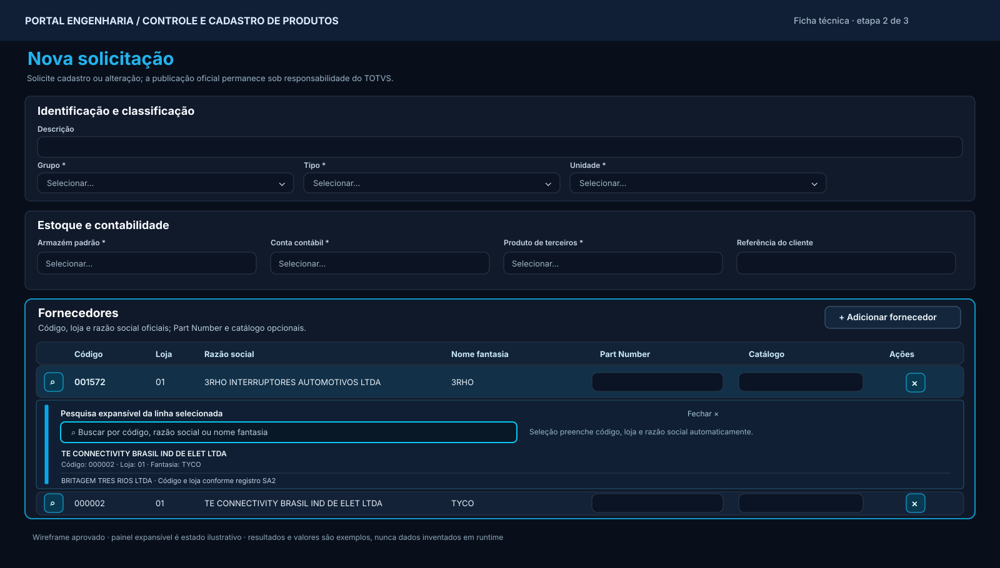

# Portal Engenharia · Cadastro de Produtos — Wireframe v2 aprovado: Fornecedores

**Status:** `PO_APPROVED_VISUAL_TARGET / TO_IMPLEMENT / PRODUCTION_DEPLOY_SUSPENDED`  
**Registro:** 2026-11-08 · **Origem:** feedback visual do PO sobre DEV depois de D10 (`0521c32248`).  
**Owner da experiência:** Portal Engenharia. **Owner do dado oficial:** TOTVS via `api-delpi`, consumida apenas pela Engineering API.  
**Natureza:** especificação visual/funções e wireframe, **não** confirmação de implementação ou autorização de deploy.



> O SVG é um **wireframe ilustrativo** com valores e resultados exemplificativos. A referência PO estabelece a intenção e a hierarquia, não pixels ou dados reais. A imagem aprovada na conversa apresentou o mesmo conceito de busca expansível integrada à linha. Não usar valores exemplificativos como dados fixos no frontend.

## 1. Problema e decisão aprovada

O componente atual da linha **Fornecedor** concatena código, loja e razão social na primeira célula e, ao mesmo tempo, repete a loja e a razão social em colunas seguintes. Isso cria redundância, desloca a edição de atributos e não torna evidente o mecanismo de busca. As ações `+ Adicionar fornecedor` e `Remover` ocupam espaço desnecessário por texto.

**Decisão:** renderizar **tabela de fornecedores normalizada**, com uma coluna estreita de ação de busca **antes da coluna Código**. Cada linha mostra somente uma vez cada atributo: Código, Loja, Razão social, Nome fantasia (se disponível no DTO autorizado), Part Number, Catálogo e Ações. A lupa da linha **abre/fecha uma área de busca expansível** conectada àquela linha; dentro dela, o usuário pesquisa exatamente como hoje por código, razão social ou nome fantasia. Selecionar registro SA2 preenche automaticamente campos oficiais; PN e Catálogo continuam editáveis. Botões de Adicionar e Remover devem trazer ícones do kit.

## 2. Wireframe desktop — tabela + área expandida

```text
┌─────────────────────────────────────────────────────────────────────────────────────────────────────┐
│ FORNECEDORES                                               [+  Adicionar fornecedor]              │
│ Código + loja + razão social obrigatórios; Part Number e catálogo opcionais                         │
├──────┬─────────┬──────┬────────────────────────────┬──────────────┬────────────┬──────────┬────────┤
│ Busca│ CÓDIGO  │ LOJA │ RAZÃO SOCIAL               │ NOME FANTASIA│ PART NUMBER│ CATÁLOGO │ AÇÕES  │
├──────┼─────────┼──────┼────────────────────────────┼──────────────┼────────────┼──────────┼────────┤
│ [⌕]  │ 001572  │ 01   │ 3RHO INTERRUPTORES...     │ 3RHO         │ [         ]│ [        ]│ [🗑]    │
├──────┴─────────┴──────┴────────────────────────────┴──────────────┴────────────┴──────────┴────────┤
│ ▼ PESQUISAR FORNECEDOR / ALTERAR SELEÇÃO                         [Fechar ×]                         │
│ [⌕ Buscar por código, razão social ou nome fantasia ..............................]                 │
│ Ao escolher um resultado, código, loja e razão social são preenchidos automaticamente.             │
│ ┌───────────────────────────────────────────────────────────────────────────────────────────────┐   │
│ │ TE CONNECTIVITY BRASIL IND DE ELET LTDA                                               [›]    │   │
│ │ Código: 000002 · Loja: 01 · Fantasia: TYCO                                                     │   │
│ ├───────────────────────────────────────────────────────────────────────────────────────────────┤   │
│ │ BRITAGEM TRES RIOS LTDA                                                                 [›]    │   │
│ │ Código/loja informados pelo registro oficial SA2                                              │   │
│ └───────────────────────────────────────────────────────────────────────────────────────────────┘   │
├──────┬─────────┬──────┬────────────────────────────┬──────────────┬────────────┬──────────┬────────┤
│ [⌕]  │ 000002  │ 01   │ TE CONNECTIVITY BRASIL...  │ TYCO         │ [         ]│ [        ]│ [🗑]    │
└──────┴─────────┴──────┴────────────────────────────┴──────────────┴────────────┴──────────┴────────┘
```

Os resultados do exemplo representam somente o **formato** de exibição. Não fixar razões sociais ou códigos de teste no MFE.

## 3. Contrato de cada coluna (sem duplicação)

| Coluna | Fonte | Modo | Regra visual |
|---|---|---|---|
| **Busca** | ação UI por linha | botão só com ícone de lupa | estreita (~44–52px); `aria-label="Buscar ou alterar fornecedor da linha N"`; `aria-expanded` |
| **Código** | `SA2.A2_COD` → `supplierCode` | somente leitura | string com zeros à esquerda; placeholder `—` até seleção |
| **Loja** | `SA2.A2_LOJA` → `store` | somente leitura | mesma linha, uma única ocorrência |
| **Razão social** | `SA2.A2_NOME` → `supplierName` | somente leitura | coluna principal, truncamento acessível com tooltip/title quando necessário |
| **Nome fantasia** | `SA2.A2_NREDUZ`, se exposto oficialmente pelo DTO | somente leitura | coluna opcional conforme contrato; sem inventar a partir da razão social; `—` se ausente |
| **Part Number** | atributo do vínculo / comparação `SA5.A5_CODPRF` | input editável | opcional, vazio legítimo, **não** é chave/wildcard |
| **Catálogo** | atributo do vínculo / campo SA5 comprovado no contrato | input editável | opcional e independente do PN |
| **Ações** | UI por linha | ícone de lixeira | compacta; label acessível; remoção e foco consistentes |

**Importante:** o modelo atual pode não trazer `supplier_short_name` até a linha selecionada ou persistir fantasia no snapshot. **Antes de exigir essa coluna preenchida**, inventariar `supplier_short_name`/DTO em api-delpi → Engineering API → MFE; se faltar, preferir ampliar uma projeção de leitura autorizada no owner correto sem alterar identidade `(supplierCode,store)` ou o DTO de persistência apenas por motivo estético. Até então mostrar `—` honesto ou omitir a coluna em layout estreito conforme decisão PO.

A primeira célula não pode exibir `001572 / 01 — RAZÃO SOCIAL` quando já existem colunas específicas. **Somente a lupa** aparece ali.

## 4. Busca colapsável por linha — máquina de estados

```text
colapsado → clique lupa → expandido (foco no input)
expandido → digitação → loading imediato (debounce + consulta remota)
loading → success (resultados) | empty | error
success → selecionar SA2 → campos oficiais preenchidos → colapsado
expandido → clique lupa / Fechar / Escape → colapsado (não apaga valor atual)
seleção existente → lupa → busca para trocar vínculo
linha removida → desmontar painel e foco volta à ação apropriada
```

- A expansão deve ser vinculada a **uma linha**, sem deslocar dados de outras linhas de forma arbitrária. Uma linha complementar `<tr><td colSpan={8}>...` é alternativa semântica; no mobile preferir área dentro do card. O seletor `AnchoredPanelPortal` do D8 pode continuar para sugestões da busca **dentro** da área expandida, evitando clipping em contêiner com scroll.
- O botão de busca abre/fecha o painel; somente uma pesquisa expansível deve estar ativa por vez, salvo contrato do kit que justifique múltiplas (padrão preferido: uma).
- Painel expandido exibe input pesquisável oficial, textos simples de orientação e resultados SA2 com **razão social na primeira linha** e **Código · Loja · Nome fantasia** na segunda.
- Preservar o conserto D10: loading imediato, debounce, requests obsoletas abortadas, empty state somente após resposta, erro/retry explícitos; **não buscar apenas na primeira página previamente carregada**.
- Escopo de consulta é SA2 remoto filtrado antes da paginação. Limite atual 20 hits e 8 visíveis não representa universo completo; manter indicação honesta ou paginação quando aplicável.
- Ao selecionar: atualizar `supplierCode`, `store`, `supplierName` **atomicamente**. Preservar PN/Catálogo da linha quando a pessoa apenas abre/fecha busca; ao **trocar fornecedor**, exigir decisão segura sobre manter/limpar atributos específicos do vínculo, sem mudança silenciosa.
- Identidade e duplicidade por `(supplierCode,store)`, não por PN ou nome. Se o resultado escolhido já estiver em outra linha, erro junto à linha e nenhuma duplicação persistida.
- Texto digitado sem seleção nunca representa fornecedor oficial. Não converter em sucesso.
- Não inferir dados oficiais de resultado de busca se o BFF não os entregou.

## 5. Botões, ícones e kit

| Controle | Apresentação | Componentes oficiais (inventariar export/props no HEAD) |
|---|---|---|
| Adicionar fornecedor | `icon plus + Adicionar fornecedor` | `EngineeringActionButton` + ícone Lucide existente via façade |
| Abrir busca | lupa, sem texto | `EngineeringActionButton` ou `IconButton` do kit; `aria-label`, `aria-controls`, `aria-expanded` |
| Fechar busca | X/chevron para recolher | button oficial; Escape também fecha |
| Remover | lixeira, sem botão largo `Remover` | icon button oficial com tooltip e confirmação somente quando necessária |
| Input busca | Select pesquisável/combobox do kit | preservar `PrcSupplierLookup`/primitivas `@delpi/plugin-ui` e `AnchoredPanelPortal` existentes |
| PN e Catálogo | inputs compactos | `EngineeringTextField`/NativeFormField official |
| Erros | indicação no campo/linha | `EngineeringStateBanner`/mensagem oficial, sem layout quebrado |

**Não importar componentes de domínio do Comercial/Suprimentos**, não criar pacote de ícones próprio e não reconstruir popover caseiro.

## 6. Responsive, acessibilidade e layout

- **Desktop:** tabela com colunas proporcionais, nome social ocupa a maior largura, código/loja/ações compactos; fantasia só se disponível; foco no campo de busca ao expandir.
- **Tablet:** tabela pode rolar horizontalmente **dentro do card**; painel expansível e sugestões não sofrem clipping; sticky header apenas se o kit suportar.
- **Mobile:** cada fornecedor vira card compacto com ação de lupa, código, loja, razão social, fantasia, PN, Catálogo e lixeira. Busca aparece expandida dentro do card. Não repetir dados.
- **Teclado:** Tab alcança lupa, seleção e lixeira; Enter/Espaço expande; Escape recolhe; setas/Enter navegam resultados; manter semântica de listbox, `aria-activedescendant` e foco restaurado; screen reader informa a linha.
- **Viewport/scroll:** scroll da tabela não pode cortar dropdown. `AnchoredPanelPortal` oficial pode ser mantido para as sugestões; verificar comportamento com scroll e flip/clamp.
- **Múltiplas linhas:** stable keys, erro por linha, adicionar foca busca da nova linha, remover não deixa portal órfão e não apaga atributos de outras linhas.
- **Não introduzir modal de fornecedor desnecessário:** o PO aprovou **componente de input colapsável na própria tabela**, não uma tela separada.

## 7. Limites de negócio e segurança

`Portal Engenharia → Engineering API → api-delpi → TOTVS`. Buscas **read-only**. Permissão `engineering.access` para operação; backend valida e publica candidato/revisão conforme workflow; não acessar TOTVS direto. `Part Number` opcional quando oficial vazio; preenchido validado em `verify_and_complete`; `Catálogo` não é PN; revisões imutáveis preservadas. Não criar nova permissão ou fluxo de publicação por este ajuste visual.

## 8. Critérios de aceite (bloqueantes para declarar PASS)

- [ ] Sem repetição: cada linha tem **colunas separadas** para Código, Loja e Razão social; primeira célula contém apenas ícone de busca.
- [ ] Botão Adicionar contém ícone `plus`; Remover é lixeira compacta com nome acessível.
- [ ] Clicar lupa expande busca **associada à linha** (input collapsável); fechar não perde a seleção atual.
- [ ] Pesquisa por código, razão social e nome fantasia retorna resultados reais autorizados. Resultado exibe razão social em destaque e código/loja/fantasia em subtítulo.
- [ ] Selecionar preenche as colunas oficiais e recolhe a busca; trocar fornecedor segue regra explícita para PN/Catálogo.
- [ ] PN e Catálogo editáveis e opcionais; vínculo duplicado bloqueado; sem salvar texto solto como fornecedor.
- [ ] 0, 1, 2+ fornecedores; desktop/tablet/mobile, zoom 200%, viewport bottom, tabela rolável e teclado testados.
- [ ] Sem dropdown cortado, sem linhas sobrepostas, sem repetição e sem overflow horizontal da página.
- [ ] Typecheck, build, Vitest, Playwright autenticado com screenshots de estados colapsado, expandido, resultado, selecionado e removido.
- [ ] Evidência em bundle realmente servido no DEV depois do rebuild; **produção não autorizada**.

## 9. Entrega ao executor / rastreabilidade

**Próxima task sugerida:** `ENG-PRC-D11-SUPPLIERS-COLLAPSIBLE-SEARCH-TABLE`.

Arquivos de partida: `plugins/engineering/src/features/product-registration/pages/PrcCreatePage.tsx`, `components/PrcSupplierLookup.tsx`, `prc.css`, `prcCopy.ts`, `engineeringUi.ts` **somente se necessário**. Preservar D7-D10 (Select TOTVS, overlay portal, busca SA2 e helps).

Estados: `PO_APPROVED_VISUAL_TARGET` para design; `IMPLEMENTATION_PENDING` para código; `VISUAL_QA_PENDING` para navegador; `PRODUCTION_DEPLOY_SUSPENDED`.


## 10. Execução integral V2 + justificativas D14

**Decisão complementar PO / documento obrigatório:** [D14 — Busca colapsável e justificativas opcionais individuais](./MFE-PRC-D14-COMPLETE-SUPPLIER-LOOKUP-AND-OPTIONAL-REASONS.md). O wireframe V2 permanece aprovado e **não foi implementado por completo** enquanto a primeira célula continuar exibindo campo de busca permanente e concatenado. A primeira célula é **somente lupa**, expandindo lookup SA2 remoto por linha; Código, Loja, Razão social, Nome fantasia (quando oficial), PN e Catálogo ocupam colunas separadas. Ícones plus/search/trash/undo, portal sem clipping, acessibilidade e mobile são critérios bloqueantes. **Justificativas opcionais:** botão expansível e textarea multilinha máx. 250 para cada campo SB1, cada PN e cada Catálogo por vínculo, e cada operação ADD/REMOVE; sem supplierReason geral; backend 422 se razão >250. Fica proibido declarar PASS V2 sem browser E2E autenticado de CREATE e UPDATE com evidência do bundle DEV. Remoção oficial depende de signoff owner; nenhuma escrita ERP.
