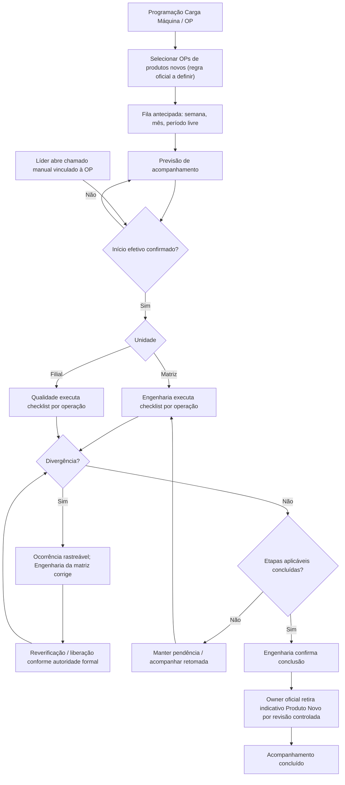

# 03 — Fluxo TO-BE candidato v0.2

**Estado:** PROPOSED; não é o BPMN AS-IS oficial.

## Distinções obrigatórias
- **Programado** é previsão; solicitação do líder e início efetivo são eventos distintos.
- **Corrigir, liberar, revisar e publicar** exigem autoridade do domínio; não criar bloqueio automático sem contrato/decisão.
- Filial tem checklist equivalente ao da matriz; Engenharia da matriz recebe tanto resultado divergente quanto conforme e efetua correção/encerramento técnico.
- OP pausada, reprogramada, cancelada ou concluída sem verificação não deve apagar histórico ou falsamente encerrar.
- Estado de conclusão depende de todas as operações aplicáveis, evidência e owner autorizado.

## Estados candidatos
PREVISTO, SOLICITADO, INICIADO, EM_ACOMPANHAMENTO, PENDENTE_CORRECAO, PAUSADO, CONCLUIDO, REPROGRAMADO, CANCELADO. Nomes, transições e persistência devem ser inventariados no domínio antes de implementar.
