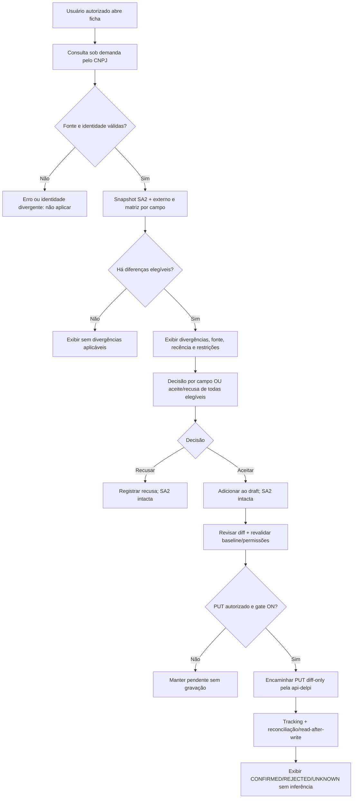

# Fornecedores — consulta externa, divergências e decisões assistidas

> **Estado: TARGET / PLANNED — DOCUMENTAÇÃO EXCLUSIVAMENTE.** Proposta de produto e arquitetura solicitada pelo PO em 2026-10-21. Não autoriza implementação, provisionamento de provider, jobs, migração, alteração de dados, deploy ou escrita em TOTVS. Revalidar authorities, `.cursor`, HEAD e contratos antes de qualquer execução. Este documento **não comprova runtime**.
>
> **Escopo nominal a confirmar:** o PO mencionou "dados de clientes cadastrados" numa conversa sobre a ficha e criação de **fornecedores**. Esta especificação cobre exclusivamente **fornecedores SA2** de Suprimentos; não autoriza tocar clientes SA1. Se "clientes" significar SA1, registrar `EXECUTION_DRIFT` e abrir especificação separada com seu owner.

## 1. Objetivo e princípios

Permitir que usuário autorizado pesquise dados cadastrais públicos do fornecedor pelo CNPJ, compare informação atual do Protheus com informação externa estruturada e **decida explicitamente** quais sugestões aceitar e quais recusar. Aceitação/recusa deve operar:
- **individualmente por campo**;
- **em lote por todos os campos divergentes elegíveis**, com prévia e exceções explícitas.

Nenhuma consulta externa altera SA2. Nenhuma aceitação é gravação automática. A execução futura de PUT é um fluxo **separado**: validação de campo editável + revisão das alterações + autorização server-side + gate operacional + tracking + confirmação de persistência. Recusa é decisão sobre **a sugestão**, nunca operação sobre valor atual no ERP. Informação de fonte pública não prevalece automaticamente sobre cadastro interno.

**Não usar IA generativa como requisito nem fonte de verdade.** Integrar fontes estruturadas oficiais quando seus contratos/condições estiverem comprovados. O cadastro pode conter dados intencionalmente diferentes da fonte externa; usuário pode recusar com justificativa.

## 2. Authority, ownership e fronteiras

Ordem: instruções oficiais do arquiteto; `.cursor`; ADR/contratos; HEAD schemas/código; testes; docs; roadmaps; histórico. O roadmap `FORNECEDORES-GESTAO-CADASTRAL-ROADMAP.md` já prevê consulta externa por CNPJ como `FUTURE/TARGET`; PR #99 contém material histórico/documental de F5 que deve ser reavaliado no HEAD. Não duplicar contratos nem declarar provider implementado por existir PR.

| Contexto | Responsabilidade alvo | Proibição |
|---|---|---|
| Keycloak | SSO / identidade | Não prover grants de negócio |
| Core API | effective permissions, apps/rotas, escopos e auditoria da plataforma | Não inferir permissão de claims JWT |
| `plugins/supplies` | interface, comparação, seleção e revisão; kit-first | Sem consulta direta a provider, `api-delpi` ou SQL |
| `supplies-api` (Flask) | **owner do fluxo produto**: orquestração, AuthZ, decisão/sugestão, políticas de leitura, estado próprio e auditoria de decisões do produto | Não consultar SQL TOTVS nem importar domínio alheio |
| `api-delpi` | regras/queries canônicas TOTVS, GET e PUT Protheus, tracking das operações enviadas por ela; eventualmente contratos de lookup genuinamente genéricos autorizados | Não fazer de dados externos a autoridade sobre SA2 |
| Providers oficiais autorizados | informação externa estruturada, proveniência e data de consulta | Não alterar ERP, não se presumir cobertura completa |

**Escolha de owner do adapter externo é um gate arquitetural:** o fluxo de enriquecimento e sua política são da `supplies-api`; avaliar reuso de gateway compartilhado na `api-delpi` ou contexto corporativo existente **apenas** se contrato genérico e ownership forem legitimados (a capacidade CEP centralizada não prova automaticamente uma capacidade de consulta de CNPJ). Não colocar regras de decisão do Portal na `api-delpi`.

**Fluxo alvo:** `MFE → supplies-api → (fonte estruturada autorizada)`, e em paralelo `supplies-api → api-delpi → leitura canônica SA2`. Se houver capacidade compartilhada de CNPJ autorizada, BFF consome-a por HTTP/S2S. Aplicação de decisões: `MFE → supplies-api → api-delpi → REST Protheus` **somente** depois de revisão, autorização e gates específicos.

## 3. O que é PROVEN e o que permanece TO_INVENTORY

**PROVEN documental:** roadmap de fornecedores prevê pesquisa CNPJ, comparação e sugestão, sem autogravação. A ficha atual já possui revisão por diff, campos protegidos e write-tracking conforme relatórios e telas do PO; implementação atual, allowlist e gating precisam ser revalidados no HEAD.

**TO_INVENTORY:**
1. Qual serviço/API governamental ou fonte oficial será usada; cobertura, autenticação, licença/termos, quotas e disponibilidade **não estão contratados aqui**. Exemplos **candidatos**, não homologados: consultas públicas/serviços autorizados de dados CNPJ da Receita Federal/REDESIM por interfaces oficiais, quando disponíveis para o tipo de consumidor e uso pretendido. **Não afirmar API aberta gratuita nem URL não verificada**. Dados abertos e consulta pública são produtos diferentes; investigar reuso de contratos existentes.
2. Qualidade e atualização por campo, atualização histórica, matriz de dados de pessoa jurídica vs. CPF, filiais e matriz, consentimento/base legal LGPD, retenção.
3. Quais atributos retornam de fato (razão social, fantasia, situação, abertura, CNAE, endereço etc.), limites de cobertura.
4. Tabelas atuais, formato/normalização e campos PUT permitidos no runtime; sem equiparar label externo ao campo SA2.
5. Estratégia de elegibilidade de campos (protegidos, editáveis, derivados, internos, fiscais, bancários).
6. Owner corporativo da consulta CNPJ caso já exista; backend authz, tráfego/custo e observabilidade.
7. Necessidade de estado durável de revisões, prazo de validade, reconsulta e retenção; definir após evidência, não inventar tabela/migration agora.

## 4. Jornadas funcionais (RQ)

**RQ-01 — Iniciar consulta.** Usuário autenticado com acesso efetivo ao fornecedor inicia `Consultar dados públicos` na ficha; consulta sob demanda é o MVP. Não iniciar varredura em lote ou job recorrente sem autorização adicional. Documentos CPF, sem dado equivalente legitimado, recebem `UNSUPPORTED`, não tentativa indevida de consulta de CNPJ.

**RQ-02 — Identidade segura.** CNPJ do fornecedor é dado de busca, não prova de ownership; comparar CPF/CNPJ canonizado, validar DV, loja, unidade e escopo. Divergência de documento ou resultado homônimo: `IDENTITY_MISMATCH`, sem sugestão aplicável.

**RQ-03 — Consulta e proveniência.** Identificar fonte, status, horário da consulta, cobertura, validade/recência, versão e request correlation. Resultados externos são sugestões não verificadas pela DELPI até passar pelos validadores aplicáveis.

**RQ-04 — Snapshot de comparação.** Congelar `current` lido da fonte canônica SA2 e `external` lido da fonte autorizada, mapeando por contrato. Cada comparação inclui `field_key`, `current_value`, `suggested_value`, `display_values`, `normalization`, `comparison_result`, `eligibility`, `reason`, `source`, `observed_at`. Nada de comparação cega por string.

**RQ-05 — Estados por campo.** `MATCH`, `DIFFERENT`, `SOURCE_MISSING`, `CURRENT_MISSING`, `NOT_COMPARABLE`, `PROTECTED`, `UNSUPPORTED`, `ERROR`. Separar `DIFFERENT` de `ELIGIBLE_TO_APPLY`: uma divergência pode não ser editável.

**RQ-06 — Decisão individual.** Para cada divergência elegível, `ACEITAR SUGESTÃO` ou `RECUSAR SUGESTÃO`; opcionalmente `ADIAR`. A decisão registra ator, instante, fonte, motivo opcional/obrigatório por política e fingerprint da proposta.

**RQ-07 — Decisão em lote.** `ACEITAR TODAS AS DIVERGÊNCIAS ELEGÍVEIS` e `RECUSAR TODAS AS DIVERGÊNCIAS ELEGÍVEIS` operam somente sobre o conjunto elegível **visível no snapshot**, respeitando filtros, protegidos e decisões prévias conforme regra congelada; requer prévia clara de número e campos, confirmação única e tratamento de falhas parciais. Não selecionar implicitamente itens filtrados/ocultos ou resultantes de outra consulta. Informar `X elegíveis / Y bloqueados / Z indisponíveis`.

**RQ-08 — Semântica da aceitação.** `ACCEPTED_FOR_DRAFT` apenas incorpora sugestão ao rascunho local/estado da revisão; **não** significa `SAVED`. Ao editar/confirmar, reutilizar fluxo diff-only atual, exigir permissão e gates e conferir contrato PUT. Quando gates OFF, permitir somente consulta, decisão/rascunho conforme política; informar explicitamente que escrita está indisponível.

**RQ-09 — Semântica da recusa.** `REJECTED_SUGGESTION` não altera SA2 nem bloqueia novas consultas; manter histórico da recusa e não reabrir automaticamente a mesma proposta idêntica sem política definida. Ao surgir evidência externa nova/material, apresentar como nova versão, sem anular recusa anterior silenciosamente. `RECUSAR TODAS` rejeita apenas o snapshot de divergências elegíveis.

**RQ-10 — Reconsulta e concorrência.** Antes de aplicar PUT, reler dados atuais e comparar com `baseline_fingerprint`; se usuário/ERP mudou registro, `STALE_COMPARISON`: descartar elegibilidade de gravação e solicitar nova revisão, jamais sobrescrever mudanças concorrentes. Consultas externas posteriores produzem novo `comparison_id`, não reescrevem decisões passadas.

**RQ-11 — Escrever somente quando autorizado.** Fluxo separado via `supplies-api → api-delpi`; somente campos na allowlist validada, nunca tax_id/código/loja/documento fiscal, nunca valores externos em campos internos não comparáveis; GET/read-after-write ou tracking conforme contrato. Um ACK/HTTP200 não comprova persistência; UNKNOWN não permite retry automático.

**RQ-12 — Experiência.** Resumo `sem divergências`, `há N divergências`, `fonte indisponível`, `dados parcialmente disponíveis`, `nova consulta necessária`. Cards por Identificação, Endereço, Contato, Fiscal e Compras (apenas atributos legitimamente mapeados). Explicar fonte, quando consultado, e mudanças. Reusar kit `@delpi/plugin-ui`; dark/light, mobile, teclado, Help sincronizada.

**RQ-13 — Segurança e auditoria.** Core efetivo + unidade + resource scope/ownership + regra de negócio, fail-closed. Restringir consultas em massa/enumeração de CNPJ, rate limit e proteção do provider. Não armazenar resposta externa completa por default; mascarar PII, logar ids/correlation e decisões mínimas, política de retenção e LGPD pendentes de validação de governança.

## 5. Matriz inicial de comparabilidade (NÃO AUTORIZA PUT)

| Externo candidato | Campo SA2/contrato candidato | Comparação alvo | Política inicial |
|---|---|---|---|
| CNPJ | `tax_id` / `A2_CGC` | validação de identidade | **PROTECTED / NEVER APPLY** |
| Razão social | `supplier_name` / `A2_NOME` | normalizar espaços/case de exibição | CANDIDATE, validar proveniência e PUT |
| Nome fantasia | `supplier_short_name` / `A2_NREDUZ` | truncamento/limite sem perda silenciosa | CANDIDATE, validar fonte e limite |
| Logradouro | `address` / `A2_END` | regra de número/complemento e tamanho | CANDIDATE, exigir revisão |
| Bairro | `district` / `A2_BAIRRO` | acentos/case sem ocultar divergência | CANDIDATE |
| CEP | `postal_code` / `A2_CEP` | 8 dígitos | CANDIDATE |
| Município/UF | `city`/`city_code`/`state` | CC2, UF e IBGE reconciliados | CONDITIONAL, indivisibilidade semântica a decidir |
| Telefone/e-mail | `phone`/`email` | confiabilidade e política de contato | CANDIDATE apenas se fonte legítima |
| CNAE/situação cadastral | sem equivalência comprovada | somente contexto informativo | READ_ONLY até contrato |
| Inscrições, natureza, condição, conta, banco | sem equivalência oficial geral comprovada | não comparar automaticamente | UNSUPPORTED |
| Código e loja | chaves SA2 | não são enriquecimento | PROTECTED |

Mapear explicitamente diferenças entre `A2_NREDUZ` (abreviação interna) e nome fantasia externo: **não presumir equivalência**. `A2_END` pode reunir logradouro+número; definir transformação com limites SX3 antes da elegibilidade. Não inferir que um campo externo faltante deve limpar o valor atual; ausência na fonte não é proposta de apagar.

## 6. Fluxo de estados proposto (sem criar tabela ainda)



**Estados de review conceituais:** `REQUESTED → FETCHED → COMPARED → AWAITING_DECISIONS → DECIDED`; exceções `SOURCE_ERROR`, `IDENTITY_MISMATCH`, `STALE_COMPARISON`, `CANCELLED`. Decisões por campo `PENDING | ACCEPTED_FOR_DRAFT | REJECTED_SUGGESTION`. Operação de escrita tem state machine próprio no tracking de `api-delpi`, sem reusar `CONFIRMED` como estado de mera decisão.

## 7. Proposta de contratos HTTP — DESIGN, NÃO ROTAS IMPLEMENTADAS

Base do BFF: `/apps/supplies-api`. Rotas e shapes abaixo são **candidatos** a confirmar no contrato OpenAPI e no código HEAD; não implementar pela existência desta documentação.

| Operação | Candidata | Semântica |
|---|---|---|
| Solicitar comparação sob demanda | `POST /suppliers/{code}/{store}/enrichment-reviews` | criação de snapshot lógico; chamada externa read-only |
| Consultar comparação | `GET /suppliers/{code}/{store}/enrichment-reviews/{review_id}` | dados e status autorizados |
| Decidir um campo | `POST /.../{review_id}/decisions` | `field_key` + `decision` + `proposal_version` |
| Decidir conjunto elegível | `POST /.../{review_id}/bulk-decisions` | decisão + `eligible_field_keys` + fingerprint |
| Preparar revisão para PUT | `POST /.../{review_id}/prepare-update` | draft/diff e validação, **não grava** |
| Gravar (futuro, contrato existente preferido) | fluxo PUT existente | autorização/gate/tracking já estabelecidos |

### Modelo lógico de resposta (exemplo fictício)

```json
{
  "review_id": "example-review-id",
  "supplier": {"code": "000001", "store": "01"},
  "status": "AWAITING_DECISIONS",
  "source": {"provider_id": "approved-source", "queried_at": "2026-10-21T12:00:00Z"},
  "baseline_fingerprint": "opaque-server-token",
  "fields": [
    {
      "field_key": "district",
      "current_display": "CENTRO",
      "suggested_display": "CENTRO NOVO",
      "comparison": "DIFFERENT",
      "eligibility": "ELIGIBLE_TO_APPLY",
      "decision": "PENDING",
      "provenance": "approved-source",
      "reason": null
    },
    {
      "field_key": "tax_id",
      "current_display": "***",
      "suggested_display": "***",
      "comparison": "MATCH",
      "eligibility": "PROTECTED",
      "decision": null
    }
  ],
  "summary": {"differences": 1, "eligible": 1, "protected": 1}
}
```

Payloads de decisão devem incluir versão/fingerprint e servidor valida escopo e elegibilidade novamente; **não confiar em `eligible_field_keys` do cliente**. Idempotência por chave da decisão, bloqueio de concorrência, conflict HTTP 409, expiração 410/409 e política de retenção pendentes de contrato. **Não coletar ou persistir snapshot completo sem aprovação LGPD.** Se armazenamento de decisões for requerido, modelar estado próprio na `supplies-api` e migration revisada, não espelhar SA2 nem gravar em `api-delpi.integration_tracking`.

## 8. Regras de aceite/recusa em lote

1. Exibir lista explícita de N itens elegíveis do snapshot selecionado; itens protegidos/informativos não entram no lote.
2. Se o usuário já tomou decisão individual, definir política: **recomendação** lote aplica apenas aos ainda pendentes; oferecer confirmação explícita para sobrescrever decisões individuais se produto optar, nunca ocultamente.
3. `Aceitar todas` apenas coloca sugestões no draft; revisão final e validação server-side antes de possível PUT.
4. `Recusar todas` só altera status de sugestões; nunca cria PUT.
5. Em caso de divergência de versão, retornar conflito e exigir reconsulta; não aplicar parcialmente sem explicar quais itens foram afetados.
6. Não aplicar documento fiscal/CNPJ, códigos/chaves, campos internos ou mapeamentos não comprovados.
7. Recusa não muda cadastro; decisão posterior pode ser revertida apenas por ação explícita enquanto revisão não expirada, com auditoria de transição.
8. `Aceitar` não inclui apagar campo quando provider traz null/vazio; clears exigem contrato independente.

## 9. Experiência proposta e ajuda

Ficha de fornecedor: ação discreta `Consultar dados públicos`. Exibir fonte, horário e ressalva de confiabilidade. Resumo `N campos diferentes · X atualizáveis · Y protegidos`. Linhas por campo:

```text
Campo        Cadastro atual     Dados externos          Decisão
Razão social ...                ...                     [Aceitar] [Recusar]
Bairro       ...                ...                     [Aceitar] [Recusar]
CNPJ/CPF     protegido          identificação            [Somente leitura]
---------------------------------------------------------------
[Recusar todas as sugestões pendentes] [Aceitar todas as sugestões pendentes]
[Revisar alterações aceitas]  [Fechar sem salvar]
```

Desktop: tabela de comparação; mobile: cards com valores empilhados; labels/Help na própria label, `@delpi/plugin-ui` first. Estados loading, vazio, parcial, indisponível, timeout, 401,403,404,409,410,429,502/503/504, comparação desatualizada e resultado sem mudança. Não exibir ação de gravar se PUT/gate não autorizado; consultar/recusar pode continuar read-only conforme policy.

## 10. Segurança, privacidade, políticas e observabilidade

- LGPD: inventariar base legal, propósito, minimização, retenção, usuários autorizados, provedor/terceiros, transferências e logs; CNPJ de pessoa jurídica pode se relacionar a pessoa física e dados de contato. Não compartilhar CPF sem capacidade aprovada.
- Evitar harvesting: rate limit por usuário/unidade/CNPJ, quotas do provider, backoff apenas para leitura, cache com TTL e particionamento/autorização; não assumir fonte em tempo real.
- Dados do provider são não confiáveis para instruções/HTML; sanitizar e nunca executar conteúdo; validar esquemas, limites SX3, origem, integridade e freshness.
- Core é authority de permissões; `supplies.access` pode ser gate de leitura **a revalidar**; decisão e escrita precisam de autorização server-side equivalente ao recurso/escopo, não criar permission por botão.
- Auditoria de negócio: ator/UUID, fornecedor code+store, unidade/recurso, provider, consulta, versão/fingerprint, campo, opção escolhida, instante, resultado, id de operação se escrita autorizada; evitar valores brutos em logs; acesso e retenção controlados.
- Observabilidade: request_id/correlation_id, métricas de consulta por fonte, diferenças, decisão, 409, falhas, retries de leitura, custo/quotas; nunca retry cego de PUT.
- Consentimento de alteração e auditoria de decisões não substituem controle de acesso efetivo.

## 11. Gates antes de qualquer implementação (STOP)

`G0 INVENTORY`: HEAD/status, authorities, PR #99 e docs F5 existentes, código real, providers disponíveis, consumidor, banco/filial, AuthZ e testes.

`G1 DATA SOURCE`: fonte oficial/autorizada, contrato/limites/licença/base legal/segurança, cobertura de atributos e taxa de atualização. Sem isso, **não criar requests externos**.

`G2 MAPPING`: mapa externo→SA2 campo a campo, tipos/limites, confiabilidade, dependências município/UF e regras de proteção; fonte ausente não limpa valor.

`G3 PRODUCT DECISIONS`: definir quais campos elegíveis, semântica do lote, recusa/reconsulta, expiração/reversão, justificativas, UX de proteção, política de estado/auditoria.

`G4 API + SECURITY`: contrato BFF, owner do adapter, AuthZ Core, quota/rate limit, paginação/TTL/cache, segurança e revisão LGPD.

`G5 IMPLEMENTATION GO`: autorização explícita do PO para a página/fatia; testes (positivo, sibling, negativo) e Help; rollback.

`G6 RUNTIME`: smoke federado, claro/escuro/mobile, teclado, 401/403/404/409, no auto-write, tracking quando material. Se não executável: `INCONCLUSIVE`, nunca PASS inferido.

**STOP CONDITIONS**: fonte não autorizada, mapeamento incerto, mudança indevida de owner, risco de alterar SA2, permissão não resolvida, conflito de contrato/field eligibility, dados pessoais sem governança, registro mudou no intervalo, tentativa de implementar por existência de roadmap.

## 12. RQ/AC e matriz de provas futuras

| AC | Critério e evidência requerida |
|---|---|
| AC-01 | Consulta externa tem proveniência e contrato aprovado |
| AC-02 | Leitura SA2 usa owner canônico, empresa/unidade e resource scope |
| AC-03 | Identidade CNPJ e fornecedor conferida antes de comparar |
| AC-04 | Matriz campo a campo distingue diferença real de formatação |
| AC-05 | Protegidos/não comparáveis nunca são elegíveis ao lote |
| AC-06 | Aceitar 1 campo muda só draft/revisão, sem PUT |
| AC-07 | Recusar 1 campo não muda SA2 |
| AC-08 | Aceitar todas somente elegíveis, com prévia e confirmação |
| AC-09 | Recusar todas somente elegíveis, com prévia e confirmação |
| AC-10 | Decisões individuais não sobrescritas silenciosamente por lote |
| AC-11 | Reconsulta/fingerprint previnem aplicação em baseline desatualizado |
| AC-12 | Apply futuro reusa PUT diff-only e tracking, com gate e AuthZ |
| AC-13 | 403/404/409/429/5xx, timeout, partial e unsupported representados |
| AC-14 | Help, desktop/mobile, dark/light, teclado/foco e modal acessíveis |
| AC-15 | Auditoria mínima/PII/retention e logs sanitizados aprovados |
| AC-16 | Testes positive + sibling + negative e sem auto-write |
| AC-17 | Documentação, contratos, evidências e SHAs registrados |
| AC-18 | Feature só é dita PASS com runtime/federated smoke executados |

**Nenhum AC está implementado por este documento.**

## 13. Decisões abertas para validação do Product Owner

| ID | Questão | Proposta padrão | Estado |
|---|---|---|---|
| D-01 | "clientes cadastrados" = fornecedores SA2 ou clientes SA1? | **fornecedores SA2**, pelo contexto deste Portal | PENDING_CONFIRMATION |
| D-02 | Busca inicial sob demanda ou monitoramento periódico? | sob demanda; jobs futuros separados | TARGET |
| D-03 | Aceitar todas inclui sugestões já recusadas individualmente? | não; somente pendentes | TARGET |
| D-04 | Recusa exige motivo? | motivo opcional com catálogo de razões a avaliar | TO_INVENTORY |
| D-05 | Pode aplicar campos externos em documento protegido? | não, apenas diagnóstico informativo | TARGET |
| D-06 | Qual provider oficial e política de uso? | inventariar fonte real antes de contratar | TO_INVENTORY |
| D-07 | Persistir decisões entre sessões/usuários? | necessário para recusa durável, mas depende de LGPD e estado próprio aprovado | TO_INVENTORY |
| D-08 | Quem autoriza decisão por recurso/unidade? | Core efetivo + regra no BFF, sem permission por campo | TARGET |
| D-09 | Atualização em massa de vários fornecedores? | fora do MVP | TARGET |
| D-10 | Quais campos externos equivalem a atributos internos? | comprovar mapeamento antes de tornar aplicável | TO_INVENTORY |

## 14. Próxima etapa autorizável — documentação/inventário apenas

Produzir inventário comparativo de provedores oficiais e contratos disponíveis; mapear SA2, campos protegidos, campos publicamente verificáveis e campos elegíveis para PUT; validar as decisões D-01..D-10 com PO; fazer avaliação de LGPD e security. Só então preparar contrato freeze e pedido explícito de GO para implementação.

**STATUS FINAL DESTA FRENTE:** `TARGET / DOCUMENTED`; `IMPLEMENTATION = NOT_AUTHORIZED`; `NO CODE / NO DEPLOY / NO WRITES`.


## Complemento específico de frontend — UX-01..UX-06

A definição detalhada de **cada superfície, navegação, wireframes desktop/mobile, 13 responsabilidades de componentes, props/estados conceituais, interação individual/em lote, modal de revisão, histórico condicional, Help, acessibilidade e 20 critérios UX-AC** está em [FORNECEDORES-ENRIQUECIMENTO-CADASTRAL-FRONTEND-UX-CONTRACT.md](./FORNECEDORES-ENRIQUECIMENTO-CADASTRAL-FRONTEND-UX-CONTRACT.md). **TARGET/DOCUMENTED; não cria rotas nem componentes**. O desenho da ficha existente é preferido a novas páginas desnecessárias. O contrato de backend ainda depende do freeze de sources, armazenamento de decisões, AuthZ, LGPD e policy do lote.


## Contrato técnico do backend — complemento proposto

O detalhamento de **Ports & Adapters, seis rotas HTTP de review/decisões/histórico/preparação, schemas JSON propostos, regras de estado, idempotência, revisão otimista, lote transacional, modelo relacional no schema supplies, AuthZ por recurso/unidade, integração ao provider CNPJ, auditoria, retenção, erros, testes e rollout** está em [FORNECEDORES-ENRIQUECIMENTO-CADASTRAL-BACKEND-TECHNICAL-CONTRACT.md](./FORNECEDORES-ENRIQUECIMENTO-CADASTRAL-BACKEND-TECHNICAL-CONTRACT.md). **PROPOSED/TARGET, não FROZEN**: fonte governamental concreta, LGPD/retention e elegibilidade de campos ainda dependem de inventário e aprovação. Nenhum endpoint/migration foi implementado.
